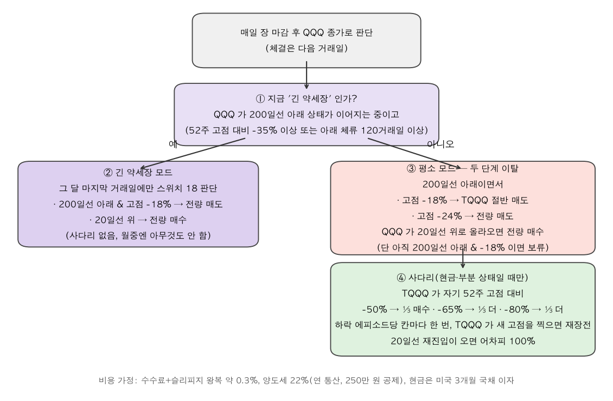
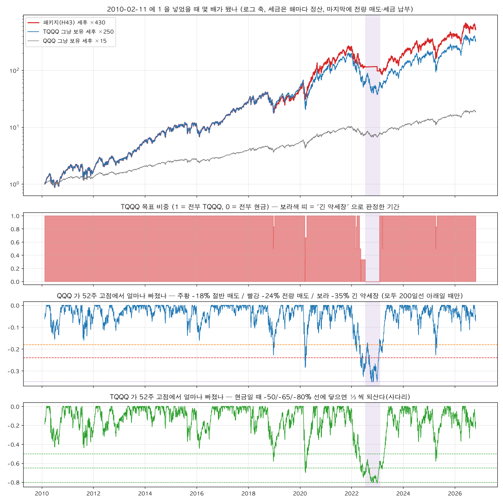
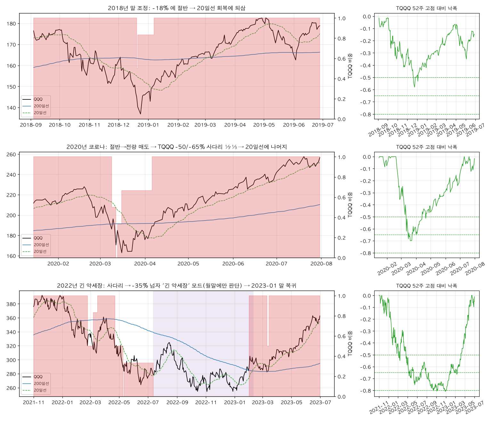
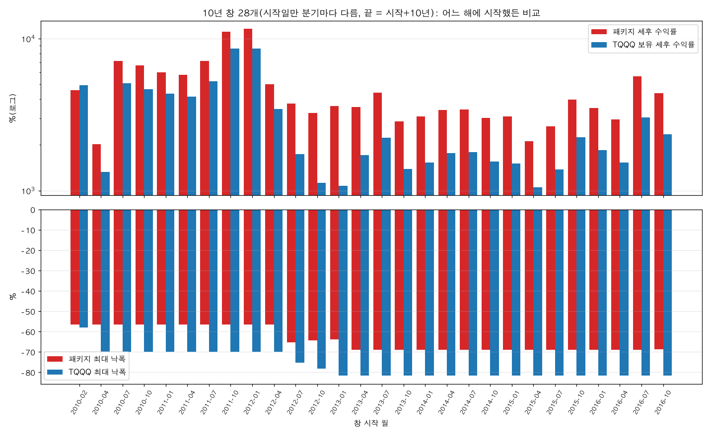

# TQQQ 넘기 탐색 — 최고 결과(H43 패키지) 쉬운 설명 (2026-11-11)

`tqqq_search_runs/` 폴더에는 2026-11-10~11 이틀 동안 자동 탐색 루프가 돌린 가설 37바퀴(H0~H43, 약 250 조합)의 설계서·결과가 들어 있다. 이 문서는 그중 **유일하게 합격(G1~G7 전부 통과)한 H43 "완성 패키지"** 가 무엇인지, 왜 최고인지, 규칙은 어떻게 작동하는지를 처음 보는 사람 기준으로 하나씩 풀어 쓴 것이다.

기술 원본: 검증 문서 `TQQQ_탐색_검증_2026-11.md` H43 절, 설계 `tqqq_search_runs/H43_설계.md`, 결과 `tqqq_search_runs/tqqq_h43_2026-11-11.md`, 봉인 해제 `tqqq_search_runs/tqqq_h43_G7_sealed.md`, 진행 장부 `tqqq_search_runs/진행상황.md`, 합격 기준 `TQQQ_탐색_프로토콜_2026-11.md`. 이 문서의 그림은 `backtester/tqqq_h43_explain_cli.py` 로 만들었다(`images/easy_tqqq_h43/`).

---

## 0. 한 줄 요약

> **"평소엔 TQQQ 를 들고 있다가, 나스닥(QQQ)이 고점 대비 −18% 면 절반·−24% 면 전부 팔고, 20일선을 회복하면 되산다. 팔고 나서 TQQQ 가 −50/−65/−80% 까지 더 빠지면 ⅓ 씩 미리 되산다. 나스닥이 −35% 넘게 빠진 '긴 약세장' 이면 한 달에 한 번만 판단한다."**

이 규칙 하나가 2010년 이후 10년 창 28개 중 27개에서 TQQQ 단순 보유를 이기고(세후 중앙 1.86배), 최악 창도 TQQQ 의 93%, 최대 낙폭은 −69%(TQQQ −82%), 닷컴·2008 을 포함한 1986년 이후 10년 창 114개 중 원금을 잃는 창이 0 이었다. 37바퀴 중 7개 관문을 전부 넘은 첫 번째이자 유일한 결과다.

---

## 1. 이 탐색은 무엇을 찾으려 했나

- **목표**: 레버리지를 새로 걸지 않고(마진·선물·옵션·2×/3× 합성 금지), **TQQQ 를 그냥 들고 있는 것보다 세후로 더 벌고 덜 깨지는 규칙**을 찾는다. TQQQ 를 사고팔거나 비중을 줄이는 것은 된다.
- **왜 어렵나**: TQQQ 단순 보유는 2010년 이후 10년 창에서 세후 중앙 +1,824%~+2,837% 다. 한국 세제(양도세 22%)에서는 **안 파는 것 자체가 세금 이연이라는 큰 이점**이라, 팔았다 되사는 규칙은 매번 세금을 미리 내는 비용을 진다(탐색 중 확인한 사실 F10). 그래서 "폭락을 피한다" 는 아이디어 대부분이 TQQQ 보유를 못 이겼다.
- **어떻게 걸렀나**: 날짜 하나로 판정하면 그 구간의 운이 결과를 좌우하므로, **10년 이상 창을 시작일만 바꿔 가며 수십 개** 만들고 창마다 TQQQ 보유와 비교했다. 그리고 수익·낙폭·5년 구간·닷컴/2008·무작위 대조·이웃 값·봉인 구간의 7개 관문(§5)을 순서대로 통과해야 합격이다. 수백 번 시도하면 운으로 통과하는 조합이 반드시 나오므로, 시도 횟수를 세고 횟수가 늘수록 무작위 대조 문턱을 올렸다.
- **결과**: 37바퀴(H0~H43) 중 합격 1(H43). 나머지 36은 대부분 첫 관문(수익)에서 떨어졌고, H23·H25·H27·H31·H38·H42 가 차례로 한 관문씩 더 넘으며 부품을 쌓은 끝에 H43 이 완성됐다(§6).

---

## 2. 왜 H43 이 "최고" 인가 — 후보 비교

`tqqq_search_runs/` 의 결과 중 3개 관문 이상 넘은 것만 추리면 다음과 같다. 숫자는 모두 개발 판(2024-06-30 까지), A-10 = 실제 TQQQ 10년 창 18개 기준.

| 가설 | 규칙 요지 | A-10 이긴 창 비율 · 세후 배수 중앙 · 최악 | B 표본(1986~, 114창) 손실 창 | 통과 관문 | 왜 거기서 멈췄나 |
|---|---|---|---|---|---|
| 스위치 18 (기존 확정 전략) | 200일선 아래 & −18% 전량 매도, 20일선 재진입 | 50% · 1.08 · — | — | G2 만 | 짧은 조정의 V 자 반등을 놓치고, 1999~2002 에 9번 왕복 |
| H23/H25 워크포워드 선택기 | 분기마다 직전 5년 성적 최고 규칙으로 갈아탐 | 78~89% · 1.13 · 0.75 | 있음 | G1~G3(+G5) | 닷컴 구간 최악 창 −16%, 이웃 값에서 무너짐 |
| H27 바닥 사다리 | 스위치 18 + 현금일 때 TQQQ −50/65/80% 에 ⅓ 씩 | 94% · 1.17 · 0.78 | 7 | G1·G2·G3·G5 | 닷컴 −99% 붕괴에선 사다리를 다 산 뒤 더 떨어짐 |
| H31 레짐 스티치 | H27 + 긴 약세장(−30%)이면 월말에만 판단 | 94% · 1.17 · 0.78 | **0** | G1~G4·G6 | 추가 대조 검사 하나가 원리상 통과 불가(§5 G5 참고) |
| H38 깊이 35% | H31 의 긴 약세장 기준을 −35%·120일로 | 94% · 1.17 · 0.78 | 0 | G1~G6 | 이탈 문턱(18%)을 흔들면 이웃이 무너짐(H39 에서 발견) |
| H42 두 단계 이탈 | −18% 절반·−24% 전량 + 사다리 | 94% · **1.46** · **0.93** | 있음 | G1~G3·G5·G6 | 긴 약세장 처리가 없어 닷컴에서 손실 창 |
| **H43 완성 패키지** | **H42 + H38 (두 단계 이탈 + 사다리 + 긴 약세장 월말)** | **94% · 1.46 · 0.93** | **0** | **G1~G7 전부** | — |

즉 H43 은 "따로따로는 한 관문씩 모자라던 두 부품(두 단계 이탈 ↔ 긴 약세장 월말)" 을 합친 것이고, 합치자 서로의 약점(A 표본 최악 창 / B 표본 닷컴 손실)이 메워졌다. 18개 조합을 돌렸는데 그중 7개가 G1~G6 를 전부 통과했고, 중심 조합(18/24 · 35% · 50%)만 봉인 구간(G7)을 열어 확인했다.

---

## 3. 규칙을 하나하나

### 3-0. 먼저 용어 세 개

| 용어 | 뜻 | 왜 쓰나 |
|---|---|---|
| **200일선** | 최근 200거래일(약 10개월) QQQ 종가 평균. 종가가 이 선 아래면 "추세가 꺾였다" 고 본다 | 폭락은 거의 항상 200일선 아래에서 깊어진다. 위에 있는 동안의 흔들림은 무시 |
| **52주 고점 대비 낙폭** | 최근 1년 최고 종가에서 몇 % 내려왔나 | "얼마나 심각한가" 의 자 — QQQ 는 −18/−24/−35%, TQQQ 는 −50/−65/−80% 선을 쓴다 |
| **20일선** | 최근 20거래일(약 1개월) 평균. 종가가 이 위로 올라오면 "반등이 시작됐다" 고 본다 | 되사는 신호. 200일선 회복을 기다리면 너무 늦다(2020년 4월 같은 V 자 반등을 놓침) |

판단은 **매일 장 마감 후 QQQ 종가**로 하고, 주문은 **다음 거래일**에 체결된다고 가정한다(TQQQ 가격이 아니라 QQQ 로 판단하는 이유: TQQQ 는 3배라 선이 너무 자주 교차한다. 사다리만 TQQQ 자기 가격을 본다).

### 3-1. 평소 모드 — "두 단계 이탈"

1. TQQQ 100% 로 시작한다.
2. QQQ 종가가 **200일선 아래**이고 **52주 고점 대비 −18%** 이면 → TQQQ **절반** 매도(현금 50%).
3. 같은 조건에서 **−24%** 까지 더 빠지면 → **나머지 전부** 매도(현금 100%).
4. 현금이나 부분 보유 상태에서 QQQ 종가가 **20일선 위**로 올라오면 → **전량 되산다**. (단 아직 200일선 아래 & −18% 조건이 그대로면 보류)

왜 두 단계인가: 종전 스위치 18 은 −18% 에서 한 번에 다 팔았다. 그러면 "−18% 를 찍고 바로 반등" 하는 경우(2018년 12월, 2025년 4월)에 바닥에서 팔고 위에서 되사는 손해가 그대로 난다. 절반만 팔면 그 손해가 절반이 되고, 진짜 폭락(−24% 이상)이면 어차피 전부 나간다. H42 에서 확인한 대로 "−18 과 −24" 라는 숫자 자체보다 **두 단계로 나눈 구조**가 효과였고, 15/21·21/27 로 바꿔도 성적이 유지된다(이웃 관문 G6 통과).

### 3-2. 사다리 — "팔고 난 뒤 더 빠지면 ⅓ 씩 미리 되산다"

현금이나 부분 보유 상태일 때 **TQQQ 자체 가격**이 자기 52주 고점 대비

- **−50%** 에 닿으면 ⅓ 매수
- **−65%** 에 닿으면 ⅓ 더
- **−80%** 에 닿으면 ⅓ 더

칸마다 하락 에피소드당 한 번만 쓴다(한 번 산 칸은 TQQQ 가 새 52주 고점을 찍어야 다시 열린다). 20일선 재진입 신호가 오면 남은 것도 전부 산다.

왜 필요한가: 스위치만 있으면 2020년 3월처럼 2주 만에 −30% 갔다가 돌아서는 장에서 "팔고 나서 20일선 회복까지 한 달을 기다려 더 비싸게" 되산다. 사다리는 **가격 축**으로 바닥 근처에서 먼저 일부를 집는다. H27 에서 이 부품 하나로 A-10 이긴 창 비율이 50% → 94% 가 됐다. 2010년 이후 실제 체결은 2018-12(−50%), 2020-03(−50%·−65%), 2022-03/05(−50%·−65%), 2025-04(−50%) 다. ⅓ 씩이 아닌 비중(½·½ 등)은 무너졌으니 비중은 그대로 둔다.

### 3-3. 긴 약세장 모드 — "한 달에 한 번만 판단"

QQQ 가 200일선 아래 상태가 5일 연속 확인된 **약세 상태**이면서 **52주 고점 대비 −35% 이상이거나 그 상태로 120거래일 이상 머물면** "긴 약세장(R-C)" 라벨이 붙는다(약세 상태는 200일선 위로 10일 연속 올라와야 꺼진다).

이 기간에는 사다리를 끄고 **원래 스위치 18(−18% 전량 매도 / 20일선 전량 매수)을 그 달 마지막 거래일에만** 판단한다. 월중에는 아무것도 하지 않는다.

왜 필요한가: 닷컴 붕괴(2000~2002, 나스닥 −83%)와 2008 에서는 매일 판단하는 스위치가 20일선 교차 때마다 들락날락해 9번 왕복하며 손해를 쌓았고, 사다리는 −80% 에서 다 산 뒤 −99% 까지 더 떨어졌다. "진짜 긴 약세장이면 느리게 판단" 하는 것이 그 구간에서 유일하게 보유를 이긴 부품이었다(H26 에서 4/4 에피소드 승). 기준이 −35% 인 이유: −30% 는 2022 처럼 짧은 것까지 잡고, −40% 는 2008 을 너무 늦게 잡는다(H38 에서 확인).

**정직하게 적어 두면**: 2010년 이후 실제 TQQQ 기간에서 이 모드는 2022-07-12~2023-02-10 **한 번**만 켜졌고, 그때는 사다리로 산 ⅓ 을 팔았다가 더 비싸게 되사서 **약간 손해**였다. 이 부품의 가치는 전부 닷컴·2008 쪽(합성 데이터 B 표본)에 있다.

### 3-4. 비용·세금 가정

| 항목 | 가정 |
|---|---|
| 수수료·슬리피지 | 토스 수수료 + 슬리피지 0.05% — 왕복 약 0.3% |
| 양도세 | 22%, 연간 실현 손익 통산, 250만 원 공제. TQQQ 단순 보유의 세금은 마지막 한 번만(보유에 유리한 쪽을 기준선에 줌) |
| 현금 이자 | 미국 3개월 국채(^IRX) |
| 체결 | 신호 다음 거래일 종가 |
| 한국 세제 정밀판(배당세 15.4% 포함) | 판정 불변(A-10 94%·1.45·0.92) |

---

## 4. 실제로 어떻게 움직였나 (2010-02-11 ~ 2026-10-24)

위 그림 읽는 법: 1번 판은 2010-02-11 에 1 을 넣었을 때 몇 배가 됐나(로그 축), 2번 판은 TQQQ 목표 비중, 3번 판은 QQQ 의 52주 고점 대비 낙폭과 −18/−24/−35% 선, 4번 판은 TQQQ 의 낙폭과 사다리 −50/−65/−80% 선. 보라색 띠가 "긴 약세장" 으로 판정된 기간(2022-07~2023-02)이다.

| | 패키지(H43) | TQQQ 그냥 보유 | QQQ 그냥 보유 |
|---|---|---|---|
| 세후 배수(16.7년) | **×430** | ×250 | ×15 |
| 최대 낙폭 | **−69%** | −82% | −35% |
| 매매 횟수 | 27 | 1 | 1 |
| 낸 세금(원금 대비) | 34.8배 | 마지막 한 번 | 마지막 한 번 |

눈으로 보이는 것 세 가지:

1. **2010~2018 은 TQQQ 와 똑같이 움직인다.** 규칙이 아무것도 안 했기 때문이다. 2011·2015·2016 의 −15% 안팎 조정은 −18% 문턱에 안 닿았다. 이 전략은 "자주 사고파는 전략" 이 아니라 **8년에 한 번 꼴로 큰 사건에서만 움직이는 전략**이다.
2. **차이는 2020 과 2022 에서 벌어진다.** 2020 은 사다리가 바닥 1주 전에 ⅔ 를 샀고, 2022 는 −24% 전량 매도 후 현금으로 −35% 구간을 건너뛰었다. 빨간 선이 파란 선 위로 올라선 뒤 그 차이가 2023~2026 상승에 복리로 실렸다.
3. **낙폭은 줄지만 여전히 −69% 다.** 2022 에 5월 전량 매도 전까지 이미 TQQQ 가 −65% 였기 때문. 이 전략은 "낙폭을 −30% 로 막는 전략" 이 아니라 "−82% 를 −69% 로 줄이면서 수익은 더 내는 전략" 이다.

### 4-1. 목표 비중이 바뀐 날 전부 (21번)

| 날짜 | 비중 | 무슨 일 | 그날 QQQ 낙폭 / 200일선 대비 | TQQQ 낙폭 |
|---|---|---|---|---|
| 2018-12-20 | 1 → ½ | 200일선 아래 & −18% → 절반 매도 | −18.3% / −11% | −50% |
| 2018-12-21 | ½ → ⅚ | 사다리 −50% ⅓ 매수(절반 상태에서) | −20.8% / −14% | −55% |
| 2019-01-07 | ⅚ → 1 | 20일선 회복 → 전량 | −14.9% / +1.3%(20일선) | −46% |
| 2020-03-09 | 1 → ½ | −18% 절반 매도 | −18.3% / −2.6% | −48% |
| 2020-03-12 | ½ → 0 | −24% 넘어 전량 매도 | −25.2% / −11% | −62% |
| 2020-03-13 | 0 → ⅓ | 사다리 −50% 칸 | −18.8% / −3.4% | −52% |
| 2020-03-16 | ⅓ → ⅔ | 사다리 −65% 칸 | −28.6% / −15% | −68% |
| 2020-04-06 | ⅔ → 1 | 20일선 회복 → 나머지 전부 | −16.9% / +6.6%(20일선) | −57% |
| 2022-02-23 | 1 → ½ | −18% 절반 매도 | −18.4% / −10% | −49% |
| 2022-03-07 | ½ → ⅚ | 사다리 −50% 칸 | −19.5% / −12% | −52% |
| 2022-03-16 | ⅚ → 1 | 20일선 회복 → 전량 | −15.7% / +1.0%(20일선) | −45% |
| 2022-04-22 | 1 → ½ | 다시 −18% 절반 매도 | −19.3% / −12% | −53% |
| 2022-05-09 | ½ → 0 | −24% 넘어 전량 매도 | −26.3% / −19% | −66% |
| 2022-05-11 | 0 → ⅓ | 사다리 −65% 칸(−50% 칸은 3월에 씀) | −27.6% / −20% | −68% |
| 2022-07-12 | ⅓ → 0 | **긴 약세장 모드 진입** → 월말 스위치가 현금 상태라 ⅓ 매도 | −28.8% / −18% | −71% |
| 2023-01-31 | 0 → 1 | 월말 판정: 20일선 위 → 전량 매수 | −20.1% / +1.3% | −64% |
| 2023-03-10 | 1 → ½ | 긴 약세장 해제 후 −18% 조건 재발 → 절반 | −21.8% / −0.3% | −67% |
| 2023-03-14 | ½ → 1 | 20일선 회복 → 전량 | −19.4% / +2.8% | −63% |
| 2025-04-04 | 1 → ½ | 관세 충격 −18% 절반 매도 | −21.5% / −14% | −56% |
| 2025-04-07 | ½ → ⅚ | 사다리 −50% 칸 | −21.4% / −14% | −56% |
| 2025-04-23 | ⅚ → 1 | 20일선 회복 → 전량 | −15.6% / +0.3%(20일선) | −48% |

(그림 생성 스크립트가 출력한 `images/easy_tqqq_h43/easy_summary.json` 의 events 를 옮긴 것. 봉인 구간인 2025-04 는 규칙이 똑같이 작동했음을 보여 준다.)

### 4-2. 세 에피소드를 확대해 보면

- **2018년 말(위)**: −18% 에 절반 팔고 이틀 뒤 사다리로 ⅓ 되사서 ⅚ 로 바닥을 지났고, 1월 초 20일선 회복에 전량. 종전 스위치 18 은 여기서 전량 팔고 1월에 더 비싸게 되샀다. 두 단계 이탈이 그 손해를 절반 이하로 줄였다.
- **2020년 코로나(가운데)**: 3/9 절반 → 3/12 전량 매도 → 3/13·3/16 사다리로 ⅔ 재매수(바닥 3/23 의 1주 전) → 4/6 20일선에 나머지. 사다리가 없었다면 4/6 에 전부 되사서 반등의 앞부분을 놓쳤다.
- **2022년 긴 약세장(아래)**: 2~3월 절반 매도·사다리·복귀를 한 번 겪고, 4~5월 다시 절반·전량 매도·사다리 ⅓. 7월에 −35% 조건으로 긴 약세장 모드가 켜져 ⅓ 을 팔고 현금으로 가을 바닥을 건넜고, 2023-01-31 월말 판정에서 전량 매수. 2월에 모드가 풀린 뒤 3월 초 짧은 절반 매도·복귀가 한 번 더 있었다.

---

## 5. 성적표 읽는 법 — 왜 "창 묶음" 이고 관문이 7개인가

### 5-1. 창 묶음

날짜 하나(예: 2016~2026)로 보면 그 구간이 2016 저점에서 시작하고 2022 폭락 뒤 회복으로 끝나는 운이 결과를 좌우한다. 그래서 **시작일을 분기마다 바꾼 10년 창**을 여러 개 만들어 창마다 "전략 세후 배수 ÷ TQQQ 보유 세후 배수" 를 재고, 그 **비율의 중앙값·최악값·1 을 넘는 창의 비율**만 본다.

| 묶음 | 무엇 | 창 수(개발 / 봉인 해제) |
|---|---|---|
| **A-10** | 실제 TQQQ 가 있는 2010-02 부터, 시작일 분기마다, 길이 10년 고정 | 18 / 28 |
| **A-∞** | 같은 시작일에서 판의 끝(2024-06 / 2026-10)까지 | 18 / 28 |
| **B-10** | 1986 년부터 ^NDX 로 합성한 3배(조달·드래그 보정) 10년 창 — 닷컴·2008 을 보기 위해. 튜닝 금지 | 114 / 123 |
| **S-5** | 5년 하위 구간(2010~15, 2015~20, 2016~20, 2020~24 등) — 어느 5년도 크게 지지 않는지 | 5 / 6 |

위 그림은 봉인 해제 판 A-10 28창이다. 막대 위 = 세후 수익률(로그), 아래 = 최대 낙폭. 28창 중 TQQQ 가 더 번 창은 가장 왼쪽 2010-02 시작 창 하나(비율 0.93)뿐이고, 나머지 27창은 패키지가 위다. 2012-07 이후 시작 창에서 차이가 크게 벌어지는 이유는 그 창들이 2022 를 포함하기 때문이다.

### 5-2. 관문 7개와 이 패키지의 점수

"개발 판" 은 2024-06-30 까지만 보고 규칙을 고른 구간, "봉인 해제 판" 은 2026-10-24 까지 늘린 구간이다. 봉인 구간(2024-07~2026-10)은 규칙을 만들 때 한 번도 보지 않았고, 합격 후보에만 가설군당 최대 2번 열 수 있다(이번이 1번째).

| 관문 | 쉬운 뜻 | 기준 | H43 중심 조합(개발 판) |
|---|---|---|---|
| **G1 수익** | 언제 시작했든 TQQQ 보유보다 많이 버나 | A-10·A-∞ 각각: 이긴 창 ≥ 70%, 비율 중앙 ≥ 1.0, 최악 창 ≥ 0.5 | A-10 **94%·1.46·0.93**, A-∞ 100%·1.81 ✅ |
| **G2 낙폭** | 덜 깨지나 | 창의 70% 이상에서 TQQQ 보다 얕고, 최악 창 MDD ≥ −80% | 100% 얕음, 최악 **−69%**(TQQQ −82%) ✅ |
| **G3 5년 구간** | 어느 5년에도 크게 지지 않나 | 모든 S-5 구간에서 TQQQ 세후 × 0.7 이상 | 5/5 (2010~15 +674%, 2015~20 +404%, 2016~20 +1,077%, 2020~24 +309%, 2021~24 +104%) ✅ |
| **G4 닷컴·2008** | 합성 3배로 본 1986~ 10년 창에서도 버티나 | TQQQ 이김 ≥ 70%, QQQ 이김 ≥ 60%, 최악 창 CAGR ≥ 0, 닷컴 포함 40창 중앙 ≥ QQQ | TQQQ 이김 79%, QQQ 이김 93%, 최악 CAGR **+1.0%**, **손실 창 0**, 닷컴 40창 중앙 +3,082%(QQQ +140%) ✅ |
| **G5 무작위 대조** | 같은 비율로 시장에 있었던 무작위 규칙 30개보다 확실히 나은가 | 백분위 ≥ 95 + min(4, N÷50)% (N=37 → 95.7%) | **100%**(무작위 최고 1.07 vs 전략 1.81) ✅ |
| **G6 이웃** | 숫자를 ±20% 흔들어도 버티나 | 이웃 조합 과반이 G1·G2 유지 | **5/5**(15/21·21/27, 깊이 30/40%, 첫 칸 45%) ✅ |
| **G7 봉인 해제** | 규칙을 만들 때 안 본 2024-07~2026-10 을 더해도 G1~G3 가 유지되나 | A-10 28창·A-∞ 28창·S-5 6구간 | A-10 **96%·1.86·0.93**(세후 중앙 +3,666% vs +1,824%), A-∞ 100%·1.75, MDD 28/28 얕음·최악 −69%, S-5 6/6 ✅ |

G5 에 대한 보충: H31 설계서에 "긴 약세장 라벨을 무작위 시점으로 옮긴 대조" 를 추가로 적어 두었는데, 2010년대에 긴 약세장이 2022 하나뿐이라 이 검사는 원리상 95% 가 나올 수 없음이 H38 에서 확인됐다(프로토콜 공식 G5 인 "런 길이 셔플" 은 100% 통과). 그래서 판정에는 공식 G5 만 썼고, 이 사실은 설계서에 사전 등록돼 있다.

봉인 구간을 더하자 중앙 비율이 1.46 → **1.86** 으로 **올랐다**. 2022 를 피하고 사다리로 산 몫이 2024~26 상승에 복리로 실렸기 때문이다. 봉인 구간에서 규칙이 한 일은 2025-04 관세 충격 한 번(절반 매도 → 사다리 → 20일선 복귀)뿐이다.

---

## 6. 어떻게 여기까지 왔나 — 부품이 쌓인 순서

| 바퀴 | 배운 것 | 남긴 부품 |
|---|---|---|
| H0 스위치 18 재평가 | 기존 확정 전략은 창 묶음으로 보면 A-10 승률 50%·1.08 — 반은 TQQQ 보유에 진다 | — |
| H1~H8, H11~H21 (기각 20개) | 거시·시장 폭·금·변동성·계절·반도체·2배·장중 15분봉·S&P 신호 전부 첫 관문 탈락. 재진입 변형 3연속 실패 | "지수 외부 정보로는 안 된다, 재진입 타이밍 변형도 안 된다" |
| H26 레짐 슬롯 | 긴 약세장(−30%) 안에서는 '월말에만 판단하는 스위치' 가 4/4 에피소드 승. 그러나 2010년대에 붙이면 세금 선납으로 손해(F10) | **긴 약세장 = 월말 스위치** |
| H27 바닥 사다리 | 현금일 때 TQQQ −50/65/80% 에 ⅓ 씩 되사기 → A-10 50% → 94%. 닷컴에선 손실 창 7 | **사다리** |
| H31 스티치 | 사다리 + 긴 약세장 월말 → 닷컴 포함 손실 창 0, 첫 G1~G4 통과 | 두 부품의 결합 |
| H38 깊이 35%·120일 | 긴 약세장 기준을 −35% 로 → G6 4/4, 가장 고른 조합 | **깊이 35%** |
| H39 문턱 축 | −18% 를 −15/−21 로 바꾸면 무너진다 — 칼날이 남아 있음 | (경고) |
| H42 두 단계 이탈 | −18% 절반·−24% 전량으로 나누면 어느 숫자든 유지, 1.17 → 1.46 | **두 단계 이탈** |
| **H43** | H42 + H38 → 18 조합 중 7개 G1~G6, 중심 조합 G7 통과 | **완성** |

기각된 바퀴도 의미가 있다. "폭락을 미리 아는 신호(거시·VIX·시장 폭·패턴)는 지수 자체보다 못하다", "장중 매매는 왕복 비용이 결론이다", "재진입을 빠르게/느리게 바꾸는 것은 효과 없다" 가 반복 확인됐고, 결국 살아남은 것은 **가격 수준(낙폭)에 따라 비중을 계단식으로 바꾸는 것**과 **큰 약세장에서 판단 빈도를 낮추는 것** 둘뿐이다.

---

## 7. 조심할 점 — 합격이 "증명" 은 아니다

1. **큰 사건 몇 개에 기댄다.** 2010년 이후 규칙이 실제로 움직인 에피소드는 2018·2020·2022(×3)·2023·2025 의 7개다. 창 28개는 서로 겹치므로 독립 표본 28개가 아니다. 미래의 폭락이 "−18% → −24% → 반등" 또는 "−35% 긴 약세장" 모양이 아닐 수 있다(예: 2000 처럼 −18% 에서 천천히 미끄러져 사다리를 다 채운 뒤 더 빠지는 경우는 B 표본에서만 봤다).
2. **진짜 새 정보는 2.3년뿐.** 개발 판과 봉인 판은 2010~2024-06 을 공유한다. 봉인 구간에서 규칙이 한 일은 2025-04 한 번이다.
3. **B 표본은 합성이다.** 1986~2010 의 3배 곡선은 ^NDX 에 조달 비용·보정 드래그를 얹어 만든 것이고, 2000-11 이전의 월말 전환은 실제 TQQQ 가 없던 시절의 가정이다.
4. **세금을 많이 낸다.** 10년 창당 매매 중앙 12.5회, 낸 세금이 원금의 약 6배(16.7년 전체로는 35배). 수익이 더 커서 세후로 이기는 것이지, 세금을 덜 내는 전략이 아니다. 실제 계좌에서는 손실 상계·계좌 분리로 달라진다.
5. **낙폭이 여전히 −69%.** 이 규칙은 반 토막을 막아 주지 않는다. "TQQQ 를 들고 있을 거라면 이 규칙이 그냥 보유보다 낫다" 는 뜻이지, TQQQ 가 안전해진다는 뜻이 아니다.
6. **긴 약세장 부품은 2010년대에 비용이었다.** 2022 에 ⅓ 을 팔았다가 더 비싸게 되샀다. 그 비용을 감수하는 이유는 닷컴·2008 형 붕괴 보험이다.

---

## 8. 다음 단계와 관련 파일

- **운용 화면**: `pages/52_TQQQ_Crash_Switch.py`(http://localhost:8501/TQQQ_Crash_Switch) 가 2026-11-11 부터 이 패키지 규칙으로 오늘의 행동·조건표·다음 트리거 가격·사다리 칸 소진·긴 약세장 라벨·세후 성적·비중 변경 이력을 보여 준다(엔진 `strategy/adapters/tqqq_package.py`). 종전 스위치 18 화면은 49 페이지(연구용)에 남아 있다.
- **추가 검증 여지**: 봉인 열람 1회 남음. 라이브러리가 바뀌면 워크포워드 선택기(H23/H30)를 재실행하기로 한 프로토콜 §5.4 는 유지.
- 파일
  - 규칙 엔진: `backtester/strategy/adapters/ladder_reentry.py`(`LadderParams.exit_steps`), `regime_slots.py`(`RegimeParams.c_depth`, `stitch`), `whipsaw_switch.py`(월말 스위치)
  - 조립·판정: `backtester/tqqq_h43_cli.py`, 관문 `strategy/adapters/tqqq_gates.py`
  - 이 문서의 그림: `backtester/tqqq_h43_explain_cli.py` → `images/easy_tqqq_h43/`
  - 원본 결과: `tqqq_search_runs/tqqq_h43_2026-11-11.{json,md}`, `tqqq_h43_G7_sealed.{json,md}`
