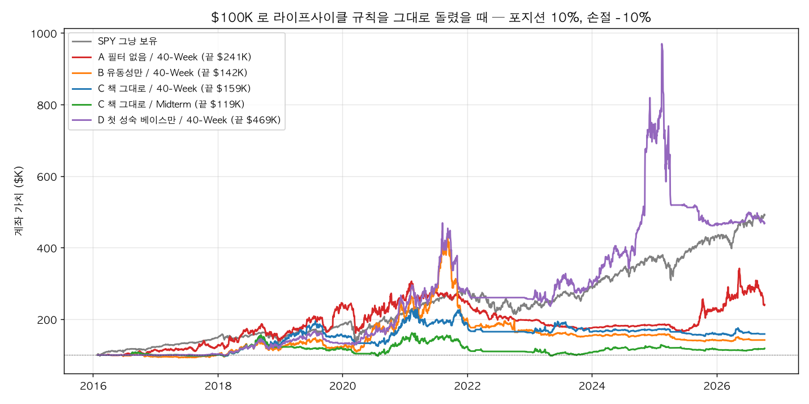
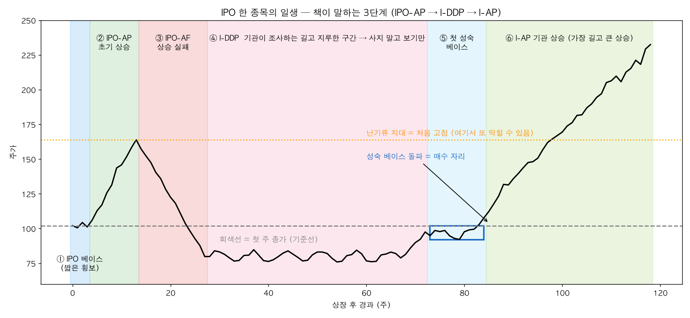
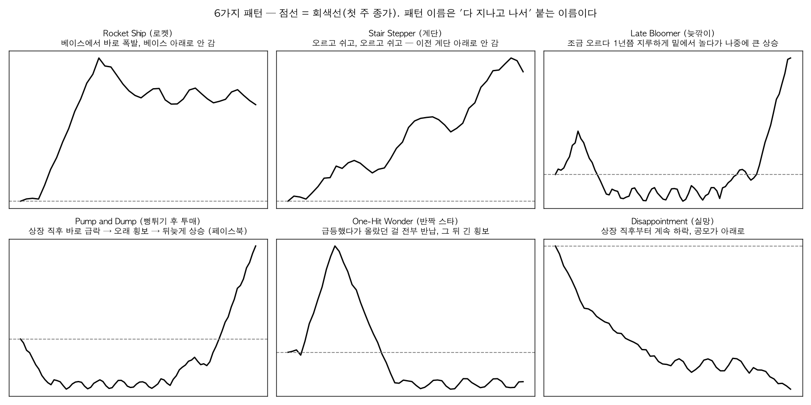
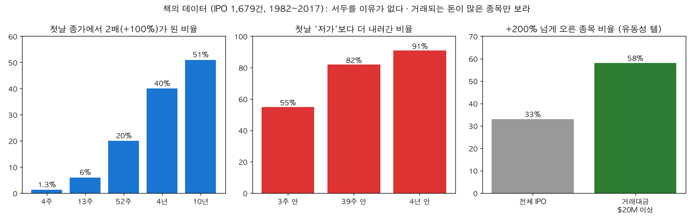
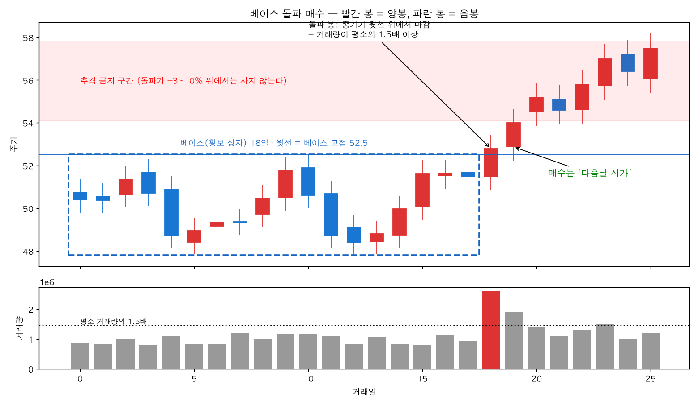
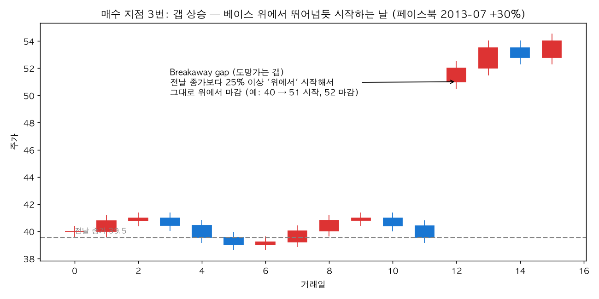
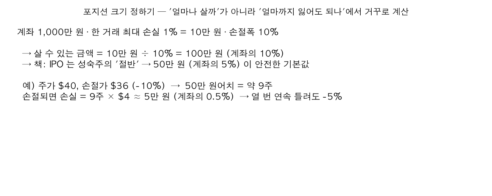
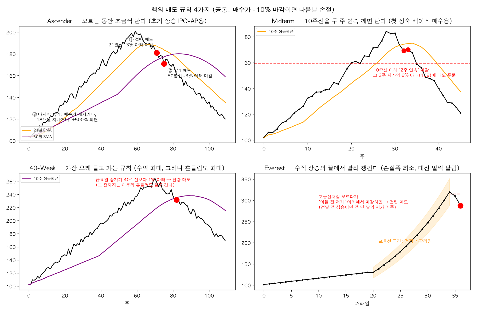
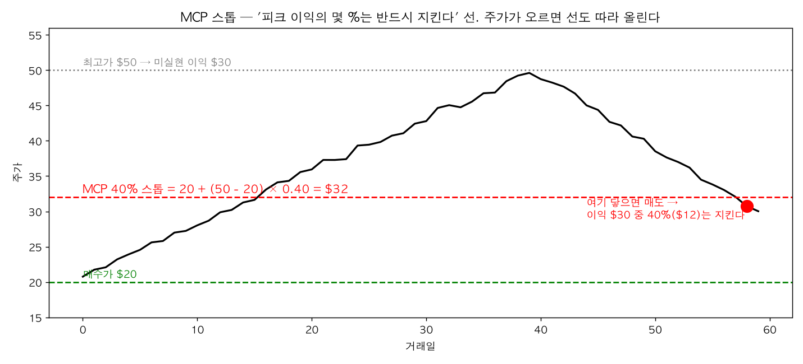

# 「The Lifecycle Trade」 쉬운 설명판 — 새로 상장한 주식(IPO)으로 돈 버는 순서

> 이 문서는 **양봉(빨간 봉)·음봉(파란 봉)이 뭔지 정도만 아는 사람**을 위해 썼다.
> 책 한 권(*The Lifecycle Trade*, 2019)의 내용을 "오늘 당장 따라 할 수 있는 순서"로 풀고, 어려운 부분은 그림을 붙였다.
> 숫자와 용어를 정확히 알고 싶으면 기술판 [`라이프사이클_트레이드_체크리스트_2026_10.md`](./라이프사이클_트레이드_체크리스트_2026_10.md)를 본다.
> 컴퓨터가 대신 계산해 주는 화면은 `localhost:8501` 의 **51 Lifecycle Trade** 페이지다.
>
> 그림은 전부 설명용으로 그린 **가짜 주가**다. 실제 종목 차트가 아니다.

---

## 0. 책이 하고 싶은 말 한 줄

> **"새로 상장한 주식은 태어나서 어른이 되기까지 정해진 길을 간다. 지금 어느 구간인지 알면, 언제 사고 언제 팔지가 정해진다."**

저자 4명은 1982년부터 2017년까지 상장한 미국 주식 **1,679개**를 전부 들여다봤다. 그래서 나온 결론 세 가지:

1. **상장 첫날 사면 안 된다.** 절반 이상이 3주 안에 첫날 가격보다 싸진다.
2. **대부분의 IPO 는 한참 지루한 구간을 거친 뒤에야 진짜로 오른다.** 그때까지는 "보기만" 한다.
3. **매도 규칙을 미리 정해 두면** 아마존·구글 같은 종목을 끝까지 들고 갈 수 있다.

### 그래서, 이대로 하면 돈을 얼마나 버나? (먼저 답부터)

2016~2023년에 상장한 미국 주식 1,245개에 이 책의 규칙을 **컴퓨터로 그대로** 적용해 봤다. 1억(= $100K)으로 시작해 2026년 10월까지 10년 반.

| 어떻게 했나 | 10년 뒤 | 1년에 | 중간에 최대 얼마나 빠졌나 |
|---|---|---|---|
| 책 규칙 전부 지킴 (거래대금 필터·강세장에서만·한 종목 10%·손절 −10%·40주선 매도) | **1.59억** | +4.4% | −36% |
| 위에서 "첫 성숙 베이스 돌파"만 삼 | 4.69억 | +15.5% | −52% |
| 그냥 S&P500 지수(SPY) 사서 가만히 둠 | **4.92억** | +16.1% | −34% |

- 규칙을 전부 지키면 **지수를 못 이긴다.** 손실은 막아 주지만 큰 수익도 같이 걸러진다.
- "첫 성숙 베이스만" 이 지수와 비슷한 건 **APP(+1,059%)·MRNA(+1,101%) 두 종목** 덕분이다. 94번 샀는데 이 둘이 수익의 87%. 둘을 빼면 첫 줄과 비슷해진다.
- 즉 이 책은 "IPO 를 많이 사는 시스템"이 아니라 **"10년에 두어 개 나오는 10배 종목을 놓치지 않는 법"** 이다. 승률은 30% 정도이니 70%는 작게 잃을 각오를 해야 한다.
- **손으로 후보를 빼면 나아지나?** 된다, 단 "언제 사는가" 기준만: ① 돌파가보다 5% 이상 올라간 뒤엔 안 산다(늦은 매수 금지) ② 갭 상승을 쫓지 않는다 ③ 상장 6개월은 기다린다 ④ 매출 없는 바이오와 공모 총액 $100M 미만은 뺀다. 이 네 가지를 지키면 10년 뒤 **5.99억(연 +18%)**으로 지수를 살짝 넘는다. 반대로 "베이스가 넓다 · 돌파 거래량이 적다 · 첫 주 가격보다 낮다"는 이유로 빼면 10배 종목을 놓쳐 더 나빠진다. 차트 모양으로는 걸러내지 말 것.
- 숫자 전체와 시나리오별 비교는 [`라이프사이클_트레이드_검증_2026-10.md`](./라이프사이클_트레이드_검증_2026-10.md) §3.5·§3.6, 화면은 51 페이지 **⑤ 계좌 시뮬** 탭.



---

## 1. 꼭 알아야 할 단어 7개 (이것만 알면 나머지는 읽힌다)

| 단어 | 쉬운 뜻 | 왜 중요한가 |
|---|---|---|
| **IPO** | 회사가 처음으로 주식시장에 상장하는 것. "첫 거래일"이 생일 | 이 책은 생일부터 3~5년 된 주식만 다룬다 |
| **공모가** | 상장할 때 회사가 정한 판매 가격 | 주가가 공모가 아래로 내려가면 "실패" 신호 |
| **회색선** | 상장 **첫 주 금요일 종가**에 그은 가로선 | 책의 모든 그림의 기준선. 이 선 위냐 아래냐로 건강을 본다 |
| **베이스(base)** | 주가가 몇 주 동안 옆으로 기어가는 **횡보 상자** | 상자 **위로 뚫고 나올 때**가 사는 자리 |
| **돌파(breakout)** | 종가가 상자 윗선 위에서 마감하는 것 | 매수 신호. 거래량이 같이 늘어야 진짜 |
| **거래대금** | 하루 거래량 × 주가 (하루에 오간 돈) | **하루 200억 원($20M) 미만은 아예 보지 않는다** |
| **이동평균선(이평선)** | 최근 N일(또는 N주) 종가의 평균을 이은 선 | 10주선·40주선·21일선·50일선 — 매도 규칙의 기준 |

이평선 하나만 더 설명하면: **10주선**은 최근 10주 금요일 종가 10개의 평균이다. 주가가 이 선 위에 있으면 "최근 10주 동안 산 사람들이 평균적으로 이익 중", 아래면 "손해 중"이라는 뜻이다. 40주선은 같은 것을 40주로 길게 본 것이다.

---

## 2. IPO 한 종목의 일생 — 3단계 (가장 중요한 그림)



| 번호 | 이름 | 무슨 일이 일어나나 | 내가 할 일 |
|---|---|---|---|
| ① | **IPO 베이스** | 상장 직후 몇 주 동안 좁게 횡보 | 상자 윗선을 적어 둔다 |
| ② | **IPO-AP** (초기 상승) | 상장 흥분으로 20~100% 오른다. 보통 20주 안에 끝난다 | 사도 되지만 **짧게**. 빨리 파는 규칙(Everest·Ascender) 필수 |
| ③ | **IPO-AF** (상승 실패) | 고점에서 **40% 넘게 빠지거나** 베이스·공모가 아래로 | 들고 있었다면 이미 팔렸어야 한다 |
| ④ | **I-DDP** (기관 실사 구간) | 몇 달~2년 동안 **지루하게 옆으로/아래로**. 큰 손들이 회사를 조사하며 조금씩 사 모으는 기간 | **절대 사지 않는다. 관찰 목록에 넣고 본다** |
| ⑤ | **첫 성숙 베이스** | 지루한 구간 끝에 생기는 **7주 이상의 횡보 상자** | 이 상자 돌파가 책이 가장 좋아하는 매수 자리 |
| ⑥ | **I-AP** (기관 상승) | 가장 길고 가장 크게 오르는 구간. 여기서 10배가 나온다 | **오래 들고 가는 규칙**(40-Week·Midterm)으로 보유 |

그림의 주황 점선 **난기류 지대**는 "처음 고점"이다. 지루한 구간을 끝내고 올라오던 주가는 여기서 한 번 더 막히는 경우가 많다(처음에 샀다가 물린 사람들이 본전에 파니까). **이 선을 힘 있게 뚫으면** 진짜 상승(⑥)이 시작된 것으로 본다.

> 핵심: **②에서는 짧게, ④에서는 쉬고, ⑤→⑥에서 길게.** 책 저자들이 돈을 잃은 사례는 전부 "②에서 길게 들고 있다가 반납"(알리바바·비자) 아니면 "⑥인데 짧은 규칙으로 털린 것"(팔로알토)이다.

---

## 3. 6가지 패턴 — "이 종목은 어떤 길을 가고 있나"



| 패턴 | 한 줄 | 실제 사례 | 어울리는 매도 규칙 |
|---|---|---|---|
| **Rocket Ship** (로켓) | 상장하자마자 폭발, 베이스 아래로 안 내려감 | eBay, First Solar | 빨리 챙기는 Everest / 조금씩 파는 Ascender |
| **Stair Stepper** (계단) | 오르고 쉬고 오르고 쉬고. 이전 계단 아래로 안 감 | 구글, 마스터카드, 서비스나우 | 오래 들고 가는 40-Week / Midterm |
| **Late Bloomer** (늦깎이) | 조금 오르다 1년쯤 지루 → 나중에 큰 상승 | 팔로알토, 테슬라, 치폴레, 쇼피파이 | 40-Week / Midterm |
| **Pump and Dump** (뻥튀기 후 투매) | 상장 직후 급락 → 공모가 아래 오래 횡보 → 뒤늦게 상승 | 페이스북, 넷플릭스, 애플 | Midterm / 40-Week |
| **One-Hit Wonder** (반짝 스타) | 급등 후 올랐던 걸 **전부 반납**. 나중에 돌아오면 "Plus" | 쉐이크쉑, 알리바바, 트윌리오, 고프로 | 빨리 파는 Everest |
| **Disappointment** (실망) | 처음부터 계속 하락. 리더가 못 됨 | 스냅, 렌딩클럽 | 사지 않는다 |

**주의**: 패턴 이름은 **다 지나고 나서** 붙는다. 사는 시점에는 "지금까지 어떤 모양인가"만 안다. 그래서 책은 패턴을 맞히려 하지 말고, **지금 단계(②인가 ⑥인가)에 맞는 매도 규칙을 고르라**고 한다.

---

## 4. 따라 하기 — 실제 순서

### STEP 1. 오늘 거래해도 되는 날인가 (환경)

- [ ] **시장이 오르는 중인가?** S&P500(SPY)·나스닥100(QQQ)이 40주 이평선 위에 있고, 그 선이 올라가고 있는가. ❌면 IPO 는 건드리지 않는다. 책에서 "가장 중요한 규칙".
- [ ] **내 계좌가 잘 되고 있는가?** 최근 거래가 연속 손실이면 쉰다.

### STEP 2. 어떤 종목을 볼 것인가 (후보 고르기)

책의 저자들은 매주 3개의 검색(스크린)을 돌린다. 51 페이지 ① 탭이 같은 것을 계산한다.

| 검색 이름 | 조건 | 쉬운 뜻 |
|---|---|---|
| **IPO Alert** | 상장 3년 이내 · 52주 저가보다 25% 이상 위 · 하루 거래대금 $20M 이상 | "최근 상장했고, 바닥에서 이미 고개를 들었고, 돈이 충분히 오가는 종목" |
| **Rare Jewels** (희귀 보석) | 90일 안에 2배 된 적 있음 · $20M · 최근 분기 매출 +50% | "초반에 미친 듯 올랐던 종목" → 책 데이터로 +500% 갈 확률이 2배 |
| **Liquidity Matters** | 3년 이내 · $20M · 매출 +50% | "돈 많이 오가고 장사 잘 되는 신규주" |

- [ ] 하루 거래대금이 **$20M(약 270억 원) 미만이면 목록에서 지운다.** 책 데이터: 전체 IPO 의 28%만 이 기준을 넘는데, +200% 오른 종목의 58%가 여기서 나왔다 (아래 그림 오른쪽).
- [ ] 회사 이름에 "Acquisition"이 들어가면(SPAC) 지운다. 공모가 $5 미만도 지운다.



왼쪽 그림: 첫날 가격에서 2배가 되는 데 **1년 걸려도 20%, 4년 걸려야 40%**. 서두를 이유가 없다.
가운데 그림: 첫날 저가보다 더 내려가는 종목이 **3주 안에 55%**. 첫날 사는 건 동전 던지기보다 나쁘다.

### STEP 3. 지금 어느 단계인가 (차트 보기)

주봉 차트를 열고 아래를 순서대로 표시한다. 51 페이지 ④ 탭이 자동으로 색칠해 주지만, **눈으로 한 번 더 확인**한다.

- [ ] **회색선**: 상장 첫 주 금요일 종가에 가로선. 지금 주가가 이 선 위인가 아래인가?
- [ ] **초기 상승(②)이 있었나**: 회색선보다 20% 이상 올라간 적이 있나? 그 고점이 어디인가 → **난기류 지대**로 적어 둔다.
- [ ] **실패(③)했나**: 고점에서 40% 넘게 빠졌거나 공모가 아래로 갔나? 그랬다면 지금은 ④ 지루한 구간이다.
- [ ] **④ 구간이면 사지 않는다.** 다만 거래량이 서서히 늘고, 실적이 좋아지면 ⑤가 가까운 것.
- [ ] **⑤ 성숙 베이스가 보이나**: 7주 이상 옆으로 기는 상자. 상자 윗선 가격을 적는다.

### STEP 4. 사는 자리 4가지 — 반드시 "돌파 직후"



| 자리 | 언제 | 비고 |
|---|---|---|
| **① IPO 베이스 돌파** | 상장 7주 안의 짧은 횡보(구글은 18일) 윗선을 종가로 돌파 | 초기 상승용. 짧게 먹고 나온다 |
| **② 초기 베이스 돌파** | 상장 7주 이후, 아직 실패(③) 전인 횡보 상자 돌파 | 역시 짧게 |
| **③ 갭 상승** (아래 그림) | 전날 종가보다 25% 이상 위에서 시작해 그대로 위에서 마감 | 페이스북 2013년 7월 +30%가 대표 사례 |
| **④ 첫 성숙 베이스 돌파** | 지루한 구간 끝의 7주+ 상자 돌파 | **책이 제일 좋아하는 자리. 길게 간다** |



공통 규칙:
- [ ] **종가**가 상자 윗선 위에서 마감한 날 확인 → **다음날 시가**에 산다.
- [ ] 돌파 날 거래량이 평소(20일 평균)의 1.5배 이상인가.
- [ ] 돌파가보다 **3~10% 이상 올라간 뒤면 사지 않는다**(추격 금지). 저자들의 큰 손실은 전부 "늦게 산" 거래였다.
- [ ] 상자가 너무 넓고 들쭉날쭉(wide and loose)하면 패스. 짧고 얕은 상자가 좋은 상자다.
- [ ] 상장 후 약 90일 전후 **락업 해제**(초기 투자자들이 팔 수 있게 되는 날)가 코앞이면 피한다.

### STEP 5. 얼마나 살까 (돈 관리) — 책의 규칙은 전부 "덜"



- [ ] **한 번에 IPO 는 1종목만.**
- [ ] 보통 종목의 **절반 크기**(계좌의 5% 정도).
- [ ] 한 거래의 최대 손실은 **계좌의 1%** 이하가 되도록 수량을 정한다.
- [ ] **손절가 = 매수가 −10%**를 적어 둔다. 종가가 이 아래로 마감하면 **다음날 무조건** 판다. 미루면 쉐이크쉑처럼 갭 하락으로 더 크게 잃는다.
- [ ] **추가 매수 금지**(책에서는 BOSS: Buy Once and Sit Still). 올라간다고 더 사면 평균 단가가 올라가 작은 흔들림에도 털린다.

### STEP 6. 어떻게 팔까 — 사기 전에 규칙을 고른다



| 규칙 | 한 줄 | 언제 쓰나 | 책 성적 (중앙값 수익 / 최대 흔들림 / 보유일) |
|---|---|---|---|
| **Everest** | 수직으로 치솟다가 **이틀 전 저가** 아래로 마감하면 전량 매도 | ② 초기 상승, 반짝 스타·로켓 | +52% / 가장 작음($33K) / 87일 |
| **Ascender** | 21일선 −3% 아래 마감 → **절반**, 50일선 −3% → **1/4**, 나머지는 매수가 깨지거나 18개월 지나거나 +500% | ② 초기 상승, 로켓·계단 | +51% / $57K / 503일 |
| **Midterm** | 10주선 아래 **2주 연속** 마감 → 그 2주 저가의 6% 아래에 매도 주문. (1년 넘게 들고 있었으면 첫 10주선 이탈에 매도) | ⑤ 첫 성숙 베이스에서 샀을 때 | +70% / $66K / 201일 |
| **40-Week** | 금요일 종가가 40주선 −1% 아래면 전량 매도. 그 전엔 무슨 일이 있어도 보유 | ⑥ 기관 상승, 확신이 클 때 | **+81%** / 가장 큼($102K) / 374일 |

읽는 법: 오래 들고 갈수록 수익은 커지지만(40-Week가 아마존에서 +1,805%) **중간에 흔들리는 폭도 커진다**. 책의 결론: "10배 종목을 잡는 유일한 방법은 40주선이 깨질 때까지 들고 가는 것, 그리고 그 흔들림을 견디는 것."

- [ ] 사기 전에 위 표에서 **규칙 하나를 고르고 종이에 적는다.** 단계가 ②면 Everest/Ascender, ⑤면 Midterm, ⑥이면 40-Week.
- [ ] 어떤 규칙이든 **손절 −10%는 항상 켜 둔다.**

### STEP 7. 흔들림을 견디는 도구 — MCP 스톱



"이익이 났는데 다 뱉을까 봐 무서워서 너무 일찍 파는 것"을 막는 선이다.

```
MCP 스톱 가격 = 매수가 + (최고가 − 매수가) × 지킬 비율
예) $20에 사서 $50까지 갔고, 이익의 40%는 지키고 싶다
    = 20 + (50 − 20) × 0.40 = $32  → $32 아래로 내려오면 판다
```

- [ ] 주가가 새 고점을 찍을 때마다 이 가격을 **다시 계산해서 올린다**(내리지는 않는다).
- [ ] 책 저자들은 35~50%를 쓴다. 45%면 "+100% 간 뒤 −27%까지, +316% 간 뒤 −40%까지" 버틴다(테슬라 사례).
- [ ] 이 도구는 **⑤→⑥ 구간에서 쓴다.** ② 초기 상승은 너무 거칠어서 맞지 않는다.

---

## 5. "하지 마라" 9가지 — 저자들이 돈 잃고 배운 것

1. 상장 첫날 사지 마라.
2. 떨어지는 주식을 "싸졌다"고 사지 마라.
3. 돌파가보다 3~10% 위에서 추격하지 마라. (마이클코어스·아카시아 손실)
4. 초기 상승(②)에서 "오래 들고 가야지" 하지 마라. (알리바바·비자 본전 회귀)
5. 반대로 기관 상승(⑥)에서 짧은 규칙으로 털리지 마라. (팔로알토)
6. 추가 매수하지 마라. 사이즈는 절반.
7. 지루한 구간(④)에서 거래하지 마라. 보기만.
8. 시장이 하락장이거나 내 계좌가 안 좋을 때 IPO 를 하지 마라.
9. 손절을 하루 미루지 마라. 본전으로 돌아왔으면 즉시 정리하라.

---

## 6. 컴퓨터가 해 주는 것 vs 내가 봐야 하는 것

**컴퓨터(51 페이지)가 해 주는 것**
- 상장일·공모가 목록 (Finnhub IPO 캘린더)
- 거래대금·52주 저가 대비 위치 → IPO Alert 등 3가지 검색
- 회색선·이평선·베이스 상자·돌파일·갭 찾기
- 단계(①~⑥) 색칠과 "지금까지의 패턴" 이름
- 4가지 매도 규칙 + 손절 + MCP 를 과거 종목에 적용했을 때의 성적표
- 책의 통계(2배 비율, 첫날 저가 이탈 비율 등)를 최근 IPO 로 다시 계산

**내 눈으로 봐야 하는 것** (51 페이지 ④ 탭에 체크박스가 있다)
- [ ] 단계 판독이 맞는가 — 회색선·난기류 지대·베이스 상자를 직접 짚어 본다. 저자들끼리도 의견이 갈렸던 부분.
- [ ] 베이스가 짧고 얕은가, 넓고 느슨한가.
- [ ] 돌파가 거래량을 동반했는가, 추격이 아닌가.
- [ ] 회사가 "세상을 바꾸는" 회사인가 — 매출 성장, 시장 지배, 촉매.
- [ ] 락업 해제·추가 공모 일정이 눈앞에 없는가.
- [ ] 시장이 상승장이고 내 계좌가 잘 되고 있는가.
- [ ] 사이즈·손절·규칙·MCP 가격을 **숫자로 적었는가.**

---

## 7. 한 장 체크리스트 — 매수 버튼 누르기 전

| # | 질문 | 답 |
|---|---|---|
| 1 | 시장이 상승장이고 내 계좌가 잘 되고 있나? | ☐ |
| 2 | 하루 거래대금이 $20M 이상인가? | ☐ |
| 3 | 지금 단계가 ② 초기 상승 / ⑤ 성숙 베이스 / ⑥ 기관 상승 중 하나인가? (④ 지루한 구간이면 패스) | ☐ |
| 4 | 4가지 매수 자리 중 하나의 **돌파 직후**인가? 추격(+3~10%)이 아닌가? | ☐ |
| 5 | 상자가 짧고 얕고, 돌파 날 거래량이 늘었나? | ☐ |
| 6 | ⑥이라면 난기류 지대(처음 고점)를 힘 있게 넘었나? | ☐ |
| 7 | 매출이 빠르게 크고(분기 +50%), 세상을 바꾸는 회사인가? | ☐ |
| 8 | 락업 해제·추가 공모가 코앞이 아닌가? | ☐ |
| 9 | 수량이 "계좌의 1% 손실" 안이고, 보통 종목의 절반이며, IPO 는 이것 하나뿐인가? | ☐ |
| 10 | 손절가(−10%)를 적었나? | ☐ |
| 11 | 단계에 맞는 매도 규칙을 **미리** 골랐나? (②Everest/Ascender · ⑤Midterm · ⑥40-Week) | ☐ |
| 12 | MCP 스톱 가격을 계산해 적었고, 본전으로 돌아오면 즉시 정리할 각오가 됐나? | ☐ |

12개 전부 ☑ 가 아니면 사지 않는다. 책 저자들은 "그래도 몇 번은 손절당하고 나서야 제대로 탄다"고 말한다. 손절 −10% × 작은 사이즈 = 계좌의 0.5% 손실이니, 틀려도 괜찮은 구조를 먼저 만드는 것이 이 책의 전부다.
