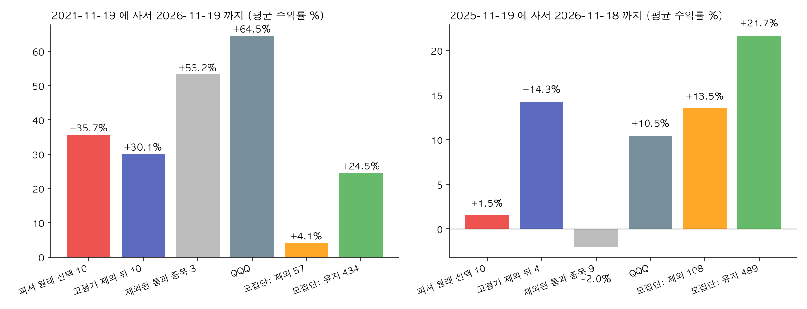
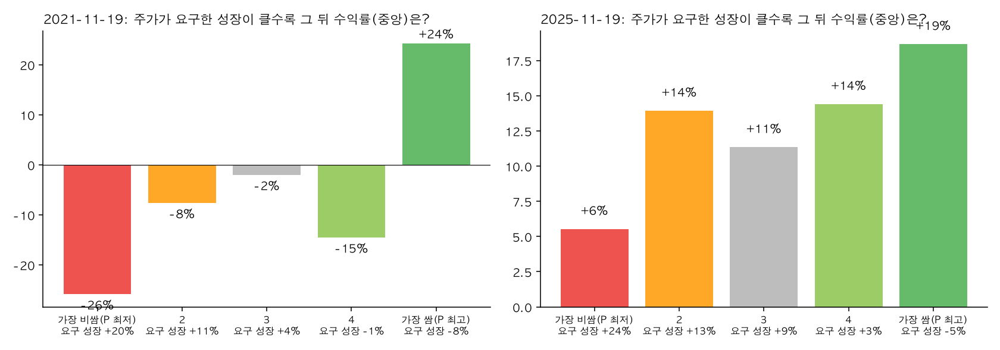

# 모부신의 "예측투자" — 좋은 회사 중에 너무 비싼 것 빼기 (쉬운 설명, 2026-11-22)

자세한 규칙은 `모부신_예측투자_고평가제외_체크리스트_2026-11.md`, 숫자 전부는 `피셔_모부신_고평가제외_검증_2026-11.md`.

## 1. 생각의 방향을 뒤집는다

보통은 이렇게 한다: "이 회사는 앞으로 이만큼 벌 것 같다 → 그러니 주가는 얼마가 맞다."

예측투자는 거꾸로다: **"지금 주가가 맞으려면 이 회사가 앞으로 얼마나 커져야 하나?"** 를 먼저 계산한다. 내 예측은 넣지 않는다. 주가가 스스로 말하게 한다.

예: 2025년 11월의 NVDA 주가가 맞으려면, 이미 매출이 수백억 달러인 회사가 **10년 동안 해마다 약 18%씩(물가 빼고)** 더 커져야 했다.

## 2. 그 기대가 지나친지는 어떻게 아나

회사 사정을 따지기 전에 **비슷한 크기의 회사들이 실제로 어땠는지**를 본다. 모부신이 65년 치 세계 대형주를 정리한 표가 있다.

| 회사 크기 (매출) | 10년 동안 보통 얼마나 컸나 (중앙) | 해마다 20% 넘게 10년을 간 회사 |
|---|---|---|
| 아주 작음 (3억 달러 이하) | 연 9.8% | 100곳 중 18곳 |
| 중간 (20~30억 달러) | 연 4.5% | 100곳 중 2곳 |
| 아주 큼 (250억 달러 초과) | 연 1.8% | 1,000곳 중 2곳 |

회사가 클수록 빨리 크기 어렵다. 그리고 **지난 몇 해 빨리 컸다고 앞으로도 그런 것은 아니다**(앞 3년과 뒤 3년의 성장률은 거의 상관이 없다).

## 3. 우리가 쓴 규칙

1. 주가에서 회사 전체 값(시가총액 + 빚 − 현금)을 구한다.
2. 이익률은 지금 그대로라고 본다(이익률은 잘 안 변한다).
3. 그 값이 되려면 10년 동안 매출이 해마다 몇 %씩 커져야 하는지 역산한다.
4. 같은 크기 회사 중 그만큼 해낸 곳이 **스무 곳 중 한 곳도 안 되면(5% 미만) "지나친 고평가"로 뺀다.**

## 4. 피셔 선택에 적용한 결과

| | 5년 전에 골랐다면 | 1년 전에 골랐다면 |
|---|---|---|
| 피셔 원래 10종목 | **+35.7%** | +1.5% |
| 비싼 것 빼고 고른 종목 | +30.1% | **+14.3%** (4종목만 남음) |
| 빠진 종목들 | +53.2% | −2.0% |

- **1년 전**: 잘 작동했다. NVDA(−19%), NFLX(−46%), MELI(−32%), APP(−26%)를 뺐다. 다만 13종목 중 9개가 빠져 4종목만 남았다.
- **5년 전**: 조금 나빠졌다. ADBE(−68%)를 뺀 것은 맞았지만 FTNT(+92%)도 같이 뺐고, 대신 들어온 것이 CDNS(+62%)와 QDEL(−94%)이었다.

## 5. 수백 종목 전체로 보면

피셔 선택 말고 모집단 전체(약 500~600종목)를 "주가가 요구한 성장" 순으로 다섯 묶음으로 나누면, **두 번 모두 가장 비싼 묶음이 가장 덜 올랐다.** 방향은 일관되지만 차이는 크지 않다.

## 6. 그래서 무엇을 알게 됐나

| 알게 된 것 | 아직 모르는 것 |
|---|---|
| 수백 종목 평균으로는 "기대가 지나친 종목"이 덜 올랐다 | 기준일 2개뿐이라 우연일 수 있다 |
| 피셔가 고른 좋은 회사는 대부분 비싸다 — 비싼 것을 빼면 피셔가 고른 것의 알맹이가 빠진다 | 비싼 것 중 **진짜 해낼 회사**를 가려내는 법 (책의 2단계, 사람의 판단) |
| "싸 보이는" 종목도 위험하다 — QDEL 은 주가가 매출 감소를 예상했고 실제로 그랬다 | 금리가 낮을 때(2021)와 높을 때(2025) 같은 잣대를 써도 되는가 |

**한 줄로**: 이 계산은 "주가가 무엇을 기대하는지"를 숫자로 보여 주는 데는 쓸모가 있었다. 그러나 그것만으로 자르는 규칙은 피셔 10종목의 성적을 한 번은 올리고 한 번은 조금 내렸다. 종목마다의 계산은 `피셔_모부신_종목별_계산과정_2026-11.md` 에 있다.

## 7. 주의

- 책은 원래 "몇 해 동안 좋은 시절이 이어져야 하나"를 계산한다. 우리는 과거 자료의 한계로 "10년간 얼마나 커져야 하나"로 바꿨다.
- 비교 표는 2015년까지의 자료다. 그 뒤 초대형 기술주들은 표에 없던 속도로 컸다.
- 할인율·세율·5% 문턱은 우리가 정한 숫자다. 바꾸면 빠지는 종목이 달라지고, 피셔 선택 쪽 결과는 부호까지 바뀐다.
