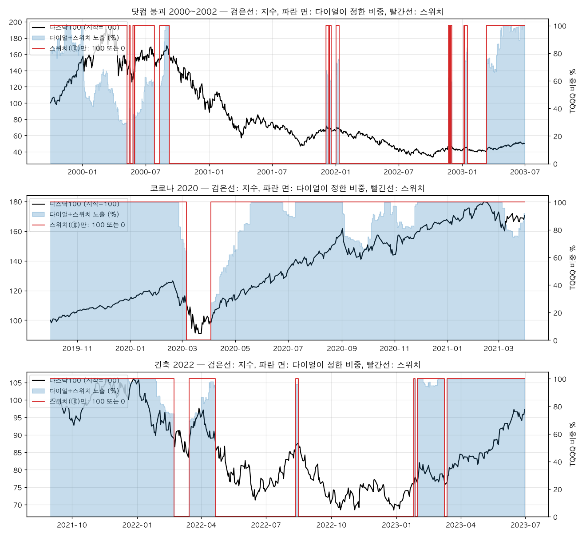
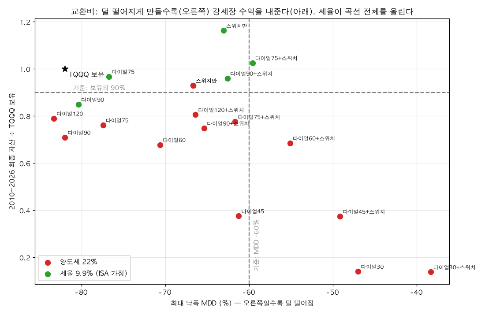
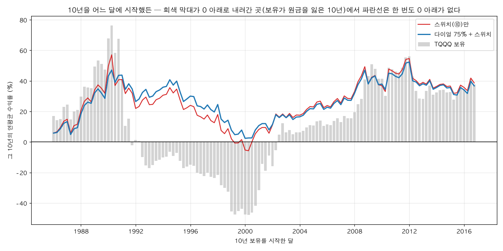

# 변동성 타기팅 × 레짐 검증 — 쉬운 설명 (2026-10-19)

> 기술판: [`변동성타기팅_레짐_검증_2026-10.md`](./변동성타기팅_레짐_검증_2026-10.md). 이 문서는 "그래서 이걸 왜 했고, 뭐가 나왔나"를 그림 3장으로 설명한다.

---

## 1. 뭘 하려는 건가 — 브레이크를 달아 보는 실험

TQQQ 를 그냥 들고 있는 건 **액셀을 끝까지 밟고 브레이크가 없는 차**다. 직선 도로(2010~2026)에선 1등이고, 큰 커브(2000년, 2008년, 2022년)에선 뒤집힌다. 2000년에 타면 27년 뒤에도 원금이다.

이 실험은 **브레이크 두 종류를 달아 보고, 직선에서 얼마나 느려지는지 재는 것**이다.

| 브레이크 | 뭐냐 | 언제 밟나 |
|---|---|---|
| **스위치 (⑩ 급락 회피)** | 전부 들고 있거나(100%) 전부 현금(0%) | 지수가 200일선 아래로 가고 **고점에서 18% 넘게** 빠졌을 때 → 0%. 20일선 위로 돌아오면 → 100% |
| **다이얼 (변동성 타기팅)** | 0~100% 사이 아무 값 | 최근 20일 변동성이 커질수록 비중을 줄인다. 비중 = 목표 변동성 ÷ 지금 변동성 (최대 100%) |

둘을 겹치면 "스위치가 켜져 있을 때만 다이얼대로"가 된다. 비교군은 보유, 그리고 스위치만.

**여기서 "레버리지"는 돈을 빌리는 게 아니다.** 3배는 TQQQ 가 안에서 한다. 우리가 정하는 건 계좌에서 TQQQ 를 100% 들지, 50% 들지(= 실효 1.5배)뿐이다.

## 2. 브레이크가 실제로 어떻게 밟혔나

검은 선이 나스닥100, 빨간 선이 스위치(100 또는 0), 파란 면이 다이얼+스위치가 정한 비중이다.

- **닷컴(위)**: 스위치는 2000년 3월 고점 뒤 18% 빠진 뒤에야 끊긴다(그 사이 TQQQ 는 −50%). 다이얼은 1월부터 변동성이 커진 걸 보고 이미 60% 로 줄여 놨다. 그래서 2000년 손실이 보유 −92%, 스위치 −75%, 다이얼+스위치 −36%.
- **코로나(가운데)**: 둘 다 3월 초에 끊고 4월에 들어온다. 스위치는 들어올 때 바로 100%, 다이얼은 변동성이 가라앉는 걸 보며 천천히 올린다. 이 해는 스위치가 더 벌었다(+169% vs +133%, 보유 +100%).
- **2022(아래)**: 빨간 선이 네 번 켜졌다 꺼진다. 이게 **휩소**다. 끊었다가 반등에 다시 들어가고 다시 떨어진다. 둘 다 −42~−57% 를 맞았다(보유 −80%).

## 3. 핵심 그림 — 브레이크의 값

가로축은 최대 낙폭(오른쪽일수록 덜 떨어짐), 세로축은 2010~2026 에 번 돈을 TQQQ 보유로 나눈 값(1.0 = 보유와 같음). 별이 TQQQ 보유다.

읽는 법은 하나다. **오른쪽으로 갈수록(덜 떨어질수록) 아래로 내려간다(강세장에서 덜 번다).** 점들이 왼쪽 위에서 오른쪽 아래로 늘어서 있다. 브레이크는 공짜가 아니다. 낙폭을 5~6%p 줄일 때마다 강세장 수익의 10% 를 낸다.

- 빨간 점(양도세 22%)은 **목표 상자(점선 오른쪽 위: 보유의 90% 이상이면서 낙폭 −60% 이내)에 하나도 못 들어간다.** 스위치만은 0.93 이지만 낙폭 −67%, 다이얼75+스위치는 낙폭 −62% 지만 0.78.
- 초록 점(세율 9.9%, ISA 가정)은 **같은 규칙인데 곡선 전체가 위로 올라간다.** 다이얼75+스위치가 1.03 / −60% 로 상자 안에 들어온다. 규칙은 하나도 안 바꿨다. 세금만 바꿨다.

그래서 이 실험의 결론은 "어떤 다이얼이 제일 좋은가"가 아니라 **"세금이 다이얼보다 크다"** 다.

## 4. 다이얼이 하는 일은 따로 있다

"10년 들고 있겠다"고 결심한 달을 1986년부터 3개월씩 옮겨 가며 124번 돌렸다. 회색 막대가 TQQQ 보유의 그 10년 연수익이다. **1992~2001년 사이에 시작한 사람은 10년 뒤 원금을 잃었다**(막대가 0 아래). 1999년에 시작하면 연 −48%.

- 빨간 선(스위치만)은 대부분 위에 있지만 2000년 시작은 −6% 다.
- **파란 선(다이얼75+스위치)은 124번 중 한 번도 0 아래로 안 간다.** 최악이 +2%.

즉 스위치는 "큰 폭락을 피하는 것", 다이얼은 "운 나쁜 시점에 시작해도 망하지 않는 것"을 담당한다. 둘은 다른 보험이다.

## 5. 결과를 한 문장씩

1. 양도세 22% 에서는 어떤 브레이크도 "보유의 90% + 낙폭 −60%" 상자에 못 들어간다. **실패다.** 기준을 바꿔 통과시키지 않았다.
2. 세율 9.9% 면 다이얼75+스위치가 상자에 들어온다. 남는 미달은 1999~ 표본의 낙폭 −70%(기준 −65%) 하나.
3. 다이얼만 있고 스위치가 없으면 2000·2008 을 못 막는다(낙폭 −93%). 변동성은 떨어지기 시작한 뒤에야 커지기 때문이다.
4. 변동성을 재는 방법은 최근 20일이면 충분했다. 더 느린 60일은 늦고, 복잡한 모델을 쓸 이유가 없다.
5. 매매를 줄여도(밴드 10%) 결과가 안 바뀐다. 강세장에서 지는 건 수수료 때문이 아니라 **줄여 놓은 날이 오른 날**이었기 때문이다. Phase 0 에서 본 대로 2010년대는 3배가 거의 최적이었다.

## 6. 그래서 다음은

세금이 제일 큰 변수로 나왔으니 **세금부터 확인한다** (Phase 3). ISA 중개형에서 국내상장 나스닥100 레버리지 ETF 를 살 수 있는지, 한도와 세율이 지금 얼마인지. 그 답에 따라 "다이얼75+스위치"가 쓸 수 있는 체계인지 아닌지가 갈린다. 그 다음이 "평소엔 100%, 변동성이 임계를 넘을 때만 줄이는" 비대칭 다이얼 실험(하루), 그 다음이 다른 수익원과 섞는 Phase 2 다.
