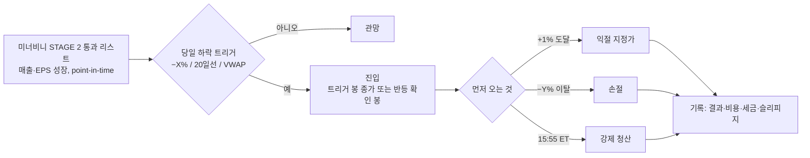

# 성장주 당일 눌림 +1% 매매 — 구체화 설계서 (2026-10-30, 코드 전 단계)

> 아이디어(사용자): "미너비니가 보는 **매출·순이익이 성장하는 기업** 리스트를 놓고, 그 종목 가격이 **떨어진 날 당일에 들어가서 +1% 정도만** 먹고 나온다."
> 이 문서는 그 한 문장을 **백테스트할 수 있는 규칙**으로 쪼개고, 사람이 정해야 할 손잡이와 함정을 먼저 적는다. 구현은 하지 않는다(`feedback_checklist_before_code`). 기존 검증 중 가장 가까운 것은 R4 코너스·라시케 단기(`코너스_라시케_단기전략_검증_2026-10.md`)와 R5 5분 ORB(`초단기_ORB_오버나이트_검증_2026-10.md`)다 — 둘 다 **왕복 비용이 이익을 먹어서** 기각됐고, 이 전략은 목표가 +1% 라 같은 벽을 먼저 넘어야 한다(§4).

---

## 0. 한 장 요약

```
 [A] 리스트           [B] 트리거(당일)        [C] 진입            [D] 청산(당일)           [E] 기록
 미너비니 STAGE 2     "떨어졌다"의 정의      시각·체결가         +1% 지정가              거래마다
 펀더멘털 통과        ① 전일 종가 −X%        · 트리거 즉시?       손절 −Y% 또는           승/패·보유분
 (발표일 ≤ 기준일)    ② 장중 고점 −X%        · 반등 확인 뒤?      장 마감 시 강제 청산    ·비용·세금
  매출 YoY·EPS YoY    ③ VWAP/20일선 터치                        (오버나이트 없음)
  ·가속·마진          ④ 전일 저가 이탈
       │                   │                    │                     │
       ▼                   ▼                    ▼                     ▼
  매일 장 시작 전      장중 감시(5분봉)     지정가/시장가 가정     셋 중 먼저 오는 것
```



**핵심 숫자 하나**: 국내 계좌 기준 왕복 비용 0.2~0.3%(토스 0.1% 양방향 + 슬리피지)와 양도세 22% 를 빼면 +1% 목표의 실제 순이익은 **약 +0.55%** 다. 손절을 −1% 로 두면 손절 1번이 익절 2.4번과 맞먹는다 → **승률 70% 이상**이 아니면 계좌가 줄어든다(§4 표). 이 벽이 설계의 출발점이다.

---

## 1. 쉬운 설명 — 이 매매법이 무엇을 믿는가

- 믿음 1: 실적이 좋아지는 회사(매출·이익 성장)는 **하루 떨어져도 금방 사는 사람이 붙는다** — 그래서 떨어진 날 사면 조금은 반등한다.
- 믿음 2: 그 반등은 크지 않아도 된다. **+1% 만 먹고 나온다** — 작은 목표라 자주 맞고, 밤에 들고 가지 않으니(당일 청산) 실적·뉴스 갭을 안 맞는다.
- 믿음 3: 미너비니의 "리스트"만 빌린다. 미너비니의 **매매법(신고가 피봇 돌파)은 쓰지 않는다** — 그는 "떨어질 때 사지 말라"고 하는 사람이라 이 전략과 정반대다. 혼동하면 안 된다.

이 세 믿음을 숫자로 검증하는 것이 §5 다. 믿음 1 은 "플라세보(아무 종목이나 같은 트리거)보다 반등률이 높은가", 믿음 2 는 "비용·세금 뒤에도 남는가", 믿음 3 은 "리스트 없이 트리거만으로도 같은가"로 잰다.

---

## 2. 규칙을 숫자로 — 손잡이와 기본값

표기: **[책]** 미너비니 책의 기준 · **[가정]** 우리가 정하는 값 · **[선택]** 사용자가 골라야 함.

### 2.1 [A] 리스트 — 어떤 회사인가

| 항목 | 기본값 | 근거·메모 |
|---|---|---|
| 소스 | 44 미너비니 스크리너 STAGE 2 (`strategy/adapters/minervini_screener.py` `GrowthResult`) | 이미 point-in-time(발표일 ≤ 기준일)으로 구현돼 있어 look-ahead 없음 |
| 조건 | 2-1 최신 분기 EPS YoY ≥ 25% [책] · 2-2 EPS 가속 · 2-3 매출 YoY ≥ 25%(또는 가속) [책] · 2-4 순이익률 개선 — **4개 중 3개** 통과 [가정] | 사용자 문장 "매출이 성장하거나 순이익이 성장"은 2-1 또는 2-3 **하나만**으로도 되는지 [선택] |
| 갱신 주기 | 매주 금요일 종가 기준으로 리스트 고정, 다음 주 사용 [가정] | 실적 발표가 주중에 나오면 다음 주부터 반영 |
| 유니버스 | 나스닥 전 종목(`nasdaq_full@기준일`) 또는 S&P500+나스닥100 [선택] | 전 종목이면 거래대금 필터 필수 |
| 유동성 | 20일 평균 거래대금 ≥ $20M, 주가 ≥ $10 [가정] | +1% 스캘프는 스프레드가 전부다. 저유동 종목은 스프레드만 0.3~1% |
| 제외 | 실적 발표일 당일·다음날 [가정], 상장 6개월 미만 | 갭 날은 "눌림"이 아니라 재평가 |
| 추세 필터 | (선택지) 없음 / 종가 > 50일선 / 미너비니 추세 템플릿 전부 [선택] | 리스트만으로는 하락 추세 종목도 들어온다. 필터를 켜면 "성장주 + 추세 위 눌림"이 된다 |
| 저PER 필터 (2026-10-30 추가) | `per_filter=industry_low`: TTM PER(발표일 ≤ 기준일 4개 분기 EPS 합) 이 **같은 산업군 중앙값 × 0.8 보다 낮을 때만** [가정 0.8, 최소 동종 3개] | "동일 산업군 대비 가격이 낮을 때". 산업군은 Alpha Vantage 스냅샷. 적자(EPS ≤ 0)는 PER 없음 → 제외. 리스트가 크게 줄어든다(연기 테스트: 17 → 1 종목/주) |

### 2.2 [B] 트리거 — "떨어졌다"의 정의 (가장 중요한 선택)

| 번호 | 정의 | 장점 | 단점 | 데이터 |
|---|---|---|---|---|
| T0 | 당일 저가가 **당일 시가 −X%** (`open`, 기본) | "당일 떨어진" 그대로. 갭은 무관, 장중 하락만 | 갭 하락 뒤 추가 하락은 시가 기준이라 작게 보임 | 일봉 OHLC (근사) → 5분봉(확정) |
| T1 | 당일 저가가 **전일 종가 −X%** (`prev_close`) | 가장 단순 | 장 초반 갭 하락과 장중 눌림을 구분 못 함 | 같음 |
| T2 | **장중 고점 −X%** | "오르다 눌린" 것만 잡음 | 장중 고점을 알아야 하므로 분봉 필수 | 5분봉 |
| T3 | 일봉 **20일선(또는 10일선) 터치** | 미너비니·근거중심매매 둘 다 쓰는 자리 | 터치가 드물어 거래 수 적음 | 일봉+분봉 |
| T4 | **전일 저가 이탈 뒤 회복** (라시케 Turtle Soup 류) | 함정 이탈을 잡음 | R4 에서 지수 기준으론 우위 없었음 | 분봉 |
| T5 | 지수(QQQ)도 같은 날 −0.5% 이상 하락 [가정 옵션] | 종목 고유 악재와 시장 눌림을 가름 | 거래 수 더 줄어듦 | 일봉 |

기본값 (2026-10-30 사용자 변경): **당일 시가 대비 −X%** (T0 `open`) — "전일 데이터가 아니라 당일 데이터로 당일 떨어진 종목". 전일 종가 대비(T1 `prev_close`)도 그리드에 같이 둔다. X 는 2/3/4, 지수 필터는 같은 기준(QQQ 저가 ≤ QQQ 시가 −0.5%)으로 켬/끔.

### 2.3 [C] 진입 — 언제, 얼마에

| 항목 | 기본값 | 메모 |
|---|---|---|
| 시각 | 트리거가 발생한 5분봉의 **다음 봉 시가** [가정] | "당일 들어간다"를 체결 가능한 가격으로 바꾼 것. 트리거 봉 저가로 체결됐다고 가정하면 과대평가 |
| 반등 확인 | (선택지) 없음 / 트리거 뒤 첫 양봉 마감 후 / 5분 RSI(14) < 30 뒤 반등 [선택] | 확인을 넣으면 승률↑ 거래 수↓ 평균 진입가↑ |
| 시간 제한 | 14:30 ET 이후 신규 진입 없음 [가정] | 남은 시간이 1시간 미만이면 +1% 가 나올 시간이 없다 |
| 비중 | 종목당 자본의 20%, 동시 최대 5 종목 [가정] | 스캘프는 포지션 집중이 아니라 회전이 수익원 |
| 하루 한 번 | 같은 종목 하루 1회 [가정] | 재진입은 변형으로 |

### 2.4 [D] 청산 — 기본은 "당일 +1% 아니면 보유" (2026-10-30 사용자 변경)

| 규칙 | 기본값 (`hold_mode=swing`) | 메모 |
|---|---|---|
| 당일 | 진입가 **+1.0%** 지정가 도달이면 그날 청산 | 체결 가정은 아래 |
| 미도달 | **보유**. 이후 일봉에서 ① 고가 ≥ 진입가 **+10%**(`tp2_pct`, 갭 상승이면 시가) ② **다음 실적 발표 1거래일 전 종가**(`earnings_exit_days_before`) ③ **기한**(`max_hold_days` 20 / 60 거래일) 종가 — 먼저 오는 것 | 발표일은 Alpha Vantage `report_date`(실제 발표일). 미래 발표일을 미리 안다고 가정 — 실전에선 예정일 |
| 가격 손절 | 기본 **없음**(`sl_pct=null`). 켜면 종가 기준 | 사용자: "손절은 기한·실적 직전 매도로" |
| 초기 설계(비교용) | `hold_mode=day`: +tp / −sl / 15:55 청산 | 그리드에서 같이 돌릴 수 있다 |
| 체결 가정 | 당일 익절·손절 판정은 일봉이면 세 경계(§7), 분봉이면 봉 순서대로. 보유 구간은 일봉 | |

### 2.6 손실 방지 필터 (2026-10-31 추가 — 검증 문서 §6-1 의 손실 거래 특징에서)

손실 거래의 80% 는 "실적 직전 강제 청산" 이고, 진입일에 이미 (1) 다음 실적이 가깝고 (2) 거래량이 평소의 1.6배 이상이며 (3) 200일선 아래·근처이고 (4) 종가가 당일 범위 하위 1/3 로 마감했다. (1)(2)(3) 은 진입 전에 알 수 있고 (4) 는 종가에만 안다.

| 손잡이 | 뜻 | 기본 | 그리드 | 근거(손실 비율, 전체 21%) |
|---|---|---|---|---|
| `min_days_to_earnings` | 다음 실적 발표까지 **거래일** 이 이보다 적으면 진입 안 함 | 0 | 0 / 20 | <26 달력일 33% vs >66일 12% |
| `max_vol_ratio` | 거래량 ÷ 20일 평균 거래량이 이보다 크면 진입 안 함. 일봉은 당일 총거래량(장중엔 모름 → 약간 낙관), 분봉은 **트리거 봉까지 누적 거래량 ÷ (20일 평균 × 경과 시간 비율)** | 없음 | 없음 / 1.5 | >1.6배 30% vs <1.1배 12% |
| `trend_filter` | 리스트 고정 시 종가 > 50일선 / 200일선 / 200일선 × 1.2 | 없음 | 없음 / sma200 / sma200+20 | 200일선 26% 위 12% vs 아래·근처 23~26% |
| `close_pos_stop` | 진입일 종가가 (종가−저가)/(고가−저가) < 이 값이면 **그날 종가에 손절** (swing 모드, 당일 익절 안 됐을 때만) | 없음 | 없음 / 0.33 | 하위 1/3 마감 35% vs 상위 1/3 10% |
| `index_drop_pct` | 기존 지수 필터의 컷. −0.5% 는 해로웠음(§5) | 0.5 | (1.5 도 시도 가능) | QQQ <−1.4% 24% vs ≥−0.1% 11% |

합격선은 §5.3 그대로(플라세보 A·B 를 +0.2%p, 세후 QQQ, 하루 최악 −5%). 필터는 거래 수를 줄이므로 "거래당" 만 좋아지고 "세후 누적" 은 그대로일 수 있다 — 둘 다 적는다. 필터 조합의 결과는 검증 문서 §13.

결과(10/31, 검증 문서 §13): 거래량·추세 필터는 분봉에서 각각 +0.5/+0.4%p, 실적 필터는 +0.04%p, 종가 손절은 −1.8%p 로 기각. 엔진 기본값을 `min_days_to_earnings=20`, `max_vol_ratio=1.5`, `trend_filter="sma200+20"` 로 바꿈(이전 실행 재현 시 cfg 에 0/null/null 명시).

### 2.7 "떨어짐" 을 자기 PER 로 정의하고, PER 이 낮은 동안 계속 보유 (2026-10-31 사용자 요청)

사용자: "(1) 떨어짐의 정의를 그 종목이 원래 갖고 있던 PER 이 많이 떨어진 시점으로 바꿔 보자. (2) 손절 기준도 바꿔서 PER 이 낮을 때는 계속 보유하면 어떻게 되나."

**PER 계산** (point-in-time): `TTM EPS` = 발표일(`effective_report_date`) ≤ 그날 인 최근 4개 분기 EPS 합(Alpha Vantage 분기, 산업군 저PER 필터와 같은 표). `PER = 종가 ÷ TTM EPS`, EPS ≤ 0 이면 없음. **"원래 PER"** = 그 종목의 **전날까지** `per_lookback`(기본 250 거래일) 일간 PER 의 **중앙값**(최소 125일). 하루씩 밀어 쓰므로 미래 값은 섞이지 않는다.

| 손잡이 | 뜻 | 기본 | 그리드 |
|---|---|---|---|
| `trigger="per_own"` | 당일 저가 기준 PER(저가 ÷ EPS) 이 **원래 PER × (1 − X%)** 이하 **처음** 내려온 날(전일 종가 PER 은 그 위). 가격으로 바꾸면 `레벨 = 원래 PER × (1 − X/100) × EPS` 이고 저가 ≤ 레벨, 전일 종가 > 레벨 — `ma20` 트리거와 같은 "교차" 꼴 | — | X 20 / 30 / 40 |
| `trigger="per_own_any"` | 교차가 아니라 **그 아래에 있는 날 전부**(자리가 비면 다음 날 들어감) | — | 같이 |
| `per_lookback` | 원래 PER 의 창 (거래일). 그리드 불가(열 하나만 만든다) | 250 | — |
| `hold_mode="per"` | 당일 +1% 없음. 진입 후 **매일 종가 PER ≥ 진입 시 원래 PER × (1 − `per_exit_pct`%)** 이면 그날 종가 청산("PER 회복"). EPS 가 0 이하·없음이 되면 종가 청산("PER 소멸" = 실적 악화). `tp2`·실적 전 청산 없음(실적을 **통과**한다), `max_hold_days` 0 이면 기한 없음 | — | `per_exit_pct` 0 / 10 |
| (비교) `hold_mode="swing"` | 기존 청산 그대로(당일 +1% / +10% / 실적 1일 전 / 60일) 에 트리거만 PER 로 | | |

- "원래 PER" 은 **진입 시점 값으로 고정**한다. 보유 중 실적이 좋게 나와 EPS 가 오르면 PER 이 더 내려가 계속 보유, EPS 가 꺾이면 PER 이 튀어 "PER 회복" 으로 팔린다 — 가격이 아니라 실적이 손절 기준이 된다는 뜻.
- EPS 는 분기 사이에 상수라 "자기 PER 20% 하락" 은 거의 "250일 중앙값 가격 대비 −20%" 와 같다. 다르게 보이는 날은 **실적 발표로 EPS 가 뛴 뒤**(가격은 안 떨어졌는데 PER 이 떨어짐) 뿐이다. 즉 이 변형은 "당일 눌림" 이 아니라 **"1년 기준 밸류에이션 20~40% 할인"** 트리거다.
- 체결: 일봉은 §7 세 경계 그대로(갭이면 시가, 아니면 레벨), 분봉은 레벨 터치 봉 다음 봉 시가. `per` 모드는 당일 청산이 없으므로 일봉 경계 차이는 진입가뿐이다.
- 플라세보 A 는 리스트 밖 종목에 같은 PER 트리거, B 는 리스트 종목 무작위 날 시가 + 같은 청산(PER 회복).
- 손실 방지 필터(§2.6 기본값)는 그대로 켠다. 단 추세 필터(200일선 +20%) 는 "PER 이 20% 이상 내려온 종목" 과 거의 양립하지 않으므로 없음/있음 을 같이 돌린다.
- 결과(10/31, 검증 문서 §14): A(기존 청산) 세후 중앙값 +215%, 플라세보 A 를 10/12 이김(당일 눌림 0/192 과 반대) 이나 QQQ 를 넘는 조합 1/12. B(PER 회복까지 보유) 거래 10~41 건, 보유 1.3~5 년, 세후 중앙값 +349%, QQQ 3/24·리스트 보유 3/24, 플라세보 B(늘 투자) 가 15/24 에서 누적으로 이김. ❌ 유지 — 종목 선택 근거로는 유효, 타이밍 전략으로는 현금 비중 때문에 보유에 진다.

### 2.5 비용·세금 [고정]

- 수수료 0.1% 양방향(토스) + 슬리피지 편도 0.05%(유동 종목) = **왕복 0.3%**. 비교용으로 IBKR Pro($0.0035/주 + 1센트)도.
- 양도세 22%: 연 손익 합산, 250만 원 공제, 손실 이월 없음(레포 공통 규칙).

---

## 3. 사람이 볼 것 (수동 체크리스트)

자동으로 못 잡는 것만 남겼다. 거래마다 한 줄.

- [ ] 떨어진 **이유**를 아는가? 실적·가이던스·규제·소송 같은 **재평가 뉴스**면 눌림이 아니다 → 건너뜀.
- [ ] 섹터 전체가 떨어지는 날인가, 이 종목만인가? (같은 섹터 ETF 등락)
- [ ] 스프레드가 지금 0.1% 이하인가? (호가창)
- [ ] 장 초반 30분 안인가? 갭 하락 뒤 첫 30분은 변동성이 커 ±1% 가 노이즈다 → 10:00 ET 이후만.
- [ ] 같은 종목에 오늘 이미 들어갔다 나왔는가?
- [ ] 미너비니 체크리스트의 **STAGE 1(추세 템플릿)** 이 깨졌는가? 깨진 종목은 "성장주"가 아니라 "성장했던 주".

---

### 3-1. 자기 PER 변형(§2.7)의 수동 체크리스트 — 레짐 표본으로만 (2026-10-31 사용자 요청)

사용자: "너무 많은 날짜를 돌리지 말고 상승장·하락장·보합장을 샘플링해서 수동 체크리스트가 잘 돌아갔는지 확인". 자동 엔진은 트리거를 **전부** 산다. 사람은 같은 후보를 보고 **건너뛸 것을 고른다**. 레짐별 표본 달에서 (a) 자동이 산 것 전부 vs (b) 사람이 통과시킨 것 의 결과를 나란히 놓으면 체크리스트가 손실을 걸러냈는지 바로 보인다.

절차(블라인드): 도구 `backtester/growth_dip_manual_cli.py`. `data` 로 가격·펀더멘털 캐시 → `candidates <YYYY-MM>` 이 그 달 리스트 종목의 자기 PER 트리거(기본 `per_own`, X 30) 를 **트리거일까지만** 그린 차트(주봉 2년·일봉 6개월·PER 선·거래량) 와 도시에(아래 항목의 숫자) 로 만든다 → 사람이 항목마다 예/아니오 + 한 줄 → 결정 JSON → `settle` 이 **다음날 시가** 체결, PER 회복(진입 시 원래 PER) 종가 청산 또는 최대 250 거래일, 같은 기간 QQQ 와 "자동(전부 매수)" 을 같이 적는다.

| 항목 | 질문 | 자동이 주는 숫자 | 건너뜀 조건(기본) |
|---|---|---|---|
| P-1 왜 싸졌나 | PER 하락이 **가격 하락** 때문인가 **EPS 상승** 때문인가? | 250일 중앙값 대비 가격 변화 / EPS 변화 분해 | 둘 다 아님(정보 없음)이면 보류 |
| P-2 재평가 뉴스 | 최근 실적 발표(±3 거래일) 갭으로 떨어졌나? 가이던스·규제·소송 재평가면 눌림이 아니다 | 마지막 발표일, 발표일 갭 %, 발표 뒤 경과일 | 발표 갭 −8% 이상이면 건너뜀 |
| P-3 EPS 추세 | 최근 4분기 EPS YoY 가 계속 플러스인가, 꺾였나? | 분기 EPS 8개 + YoY | 최근 분기 YoY 음수면 건너뜀 |
| P-4 원래 PER 이 정상이었나 | 250일 PER 창의 최소·중앙·최대. 중앙값이 거품(60 이상)이었다면 "할인" 이 아니다 | PER 창 통계, 현재 PER | 중앙 PER ≥ 60 이면 건너뜀 |
| P-5 시장 vs 종목 | 같은 기간 QQQ 도 떨어졌나(시장 눌림), 이 종목만인가(고유 악재)? | 60일 종목 수익 vs QQQ, 섹터 ETF 는 없음 | 종목만 −30% 이상이면 이유를 적고 보류 |
| P-6 추세 템플릿 | 미너비니 STAGE 1 이 아직 사는가: 200일선 위? 50일선? 52주 고점 대비 −25% 이내? 200일선 기울기? | 전부 숫자 | 200일선 아래 + 52주 고점 −40% 이하면 "성장했던 주" |
| P-7 거래량 | 트리거 주변 5일 거래량이 평소의 2배 이상(뉴스 동반)인가? | vol5/vol20 | 2배 이상이면 P-2 를 다시 본다 |
| P-8 차트 큰 그림 | 주봉에서 하락 채널·매물대 아래 이탈인가, 상승 추세 안의 눌림인가? | 차트(사람) | 하락 채널 안이면 건너뜀 |

결정: **매수 / 건너뜀** + 한 줄. 판정 기록은 `docs/strategy_notes/growth_dip_runs/growth_dip_manual_2026-10-31/<월>/decisions.json`, 결과는 검증 문서 §15.

결과(10/31, 검증 문서 §15): 6 달 46 건. 사람이 산 11 건 1년 평균 +7.6%, 버린 35 건 +21.9%, 자동 전부 +18.5%. P-6/P-8(추세) 로 거른 22 건이 +32% — PER 눌림은 추세가 꺾인 자리에서 나오므로 추세 항목은 이 변형과 양립하지 않는다. P-1 은 반대로 적용해야 했다(EPS 상승형 +4%, 가격 하락형 +31%). P-4(PER ≥ 60) 만 2021 거품에서 맞았다.

### 3-2. 데이터로 고친 자기 PER 수동 체크리스트 (2026-10-31, 검증 문서 §16 — 532 건, 앞뒤 기간 모두 같은 방향인 항목만)

§3-1 을 사람이 적은 대로 적용하면 거꾸로 작동했다(§15). 자동 결과 532 건을 손실/이익으로 나눠 진입일 특징을 비교한 결과로 고친 판:

| 항목 | 질문 | 숫자 | 판정 |
|---|---|---|---|
| Q-1 **왜 싸졌나** | 가격이 250일 중앙값보다 **10% 이상 낮은가** (가격 하락형)? | `px_vs_med ≤ −10%` | 아니오(EPS 가 뛰어 싸진 것)면 **건너뜀** — 손실 35~42% vs 12~13% |
| Q-2 **자리** | 종가가 200일선보다 **10% 이상 아래** 인가? | `px_vs_sma200 ≤ −10%` | 아니오면 건너뜀 — 위는 손실 35~44%, 아래는 12%. §3-1 P-6/P-8 과 정반대 |
| Q-3 원래 PER 이 진짜인가 | 250일 PER 창의 **최대 ÷ 원래 PER < 1.5** 인가? (적자 탈출 직후 PER 100+ 가 섞이면 할인이 가짜) | `win_max/ref` | 1.5 이상이면 건너뜀 |
| Q-4 EPS 추세 | 최근 분기 EPS YoY 가 **0 ~ +100%** 인가? | `last_yoy` | +100% 초과(저베이스·피크 EPS)는 손실 29~36% → 건너뜀. 음수는 Q-1 과 겹치면 허용 |
| Q-5 발표 뒤 | 마지막 실적 발표 뒤 **13 거래일 이상** 지났나? | `days_since_report` | 12 일 이내는 손실 25~34% → 기다림 |
| Q-6 (참고) | 주가 $116 이상 고가 종목인가? | | 약한 신호(손실 24~36%). 비중만 줄임 |
| 삭제 | §3-1 의 P-5 시장 vs 종목, P-7 거래량, P-2 갭 크기, P-6/P-8 추세, P-4 "PER ≥ 60" | | 기간을 넘어 유지되지 않음 |

엔진 손잡이(10/31, 전부 기본 꺼짐, 플라세보 A 에도 같이 적용): `px_below_med_pct`(Q-1, 전일 종가 ≤ 250일 가격 중앙 × (1−v%)) · `below_sma200_pct`(Q-2) · `per_ref_max_ratio`(Q-3, PER 창 최대 ÷ 원래 < v) · `max_last_yoy`(Q-4, 발표 순서 4개 전 분기 대비) · `min_days_since_report`(Q-5). 그리드 결과는 검증 문서 §17.

규칙 P(Q-2 & Q-3)만으로 532 건 중 188 건: 중앙 +30%, 손실 14%(앞 15 / 뒤 13), PER 회복 44%. Q-1 까지 더하면 73 건: 손실 10%, 최악 −29%. 걸러진 344 건은 손실 33%, 최악 −78%. **한계**: 이 체크리스트는 "어느 PER 눌림이 안 망하나" 를 고를 뿐 QQQ 초과(앞 기간 −6%)는 보장하지 않고, 규칙을 만든 표본 안에서 확인한 것이므로 2026 이후 새 표본에서 다시 봐야 한다.

## 4. 먼저 넘어야 할 벽 — +1% 목표와 비용의 산수

(아래 표는 초기 설계 `day` 모드 기준. `swing` 모드는 미도달 거래가 당일 손실로 끝나지 않고 +10%/실적 전/기한으로 넘어가므로 "당일 익절 비율 × 0.7% + 보유 거래의 평균 손익"이 거래당 기대값이다. 그리드 결과에 두 값을 따로 적는다.)

순이익(세전) = 익절 +1.0% − 왕복 0.3% = **+0.7%**. 손절 −Y% 의 실제 손실 = −(Y + 0.3)%. 손익분기 승률 p\* = (Y+0.3) / (0.7 + Y + 0.3).

| 손절 Y | 익절 순 | 손절 순 | 손익분기 승률 | 세후(22%)로 같은 기대값 내려면 |
|---|---|---|---|---|
| −0.5% | +0.7% | −0.8% | **53%** | 승률 +3%p 더 |
| −1.0% | +0.7% | −1.3% | **65%** | +3%p |
| −1.5% | +0.7% | −1.8% | **72%** | +3%p |
| 손절 없음(당일 청산) | +0.7% | 평균 종가 손실(측정 필요) | 측정 | |

- 참고: R4 코너스 RSI(2)는 **승률 67%, 거래당 +1.3%** 였는데도 시장 노출 13% 라 장기보유에 졌다. 이 전략은 노출이 더 짧다(당일). 즉 승률이 70% 를 넘어도 **연 수익이 지수를 이기려면 거래 수가 많아야 한다** — 거래당 순 +0.3%(승률 70%, Y=1) × 연 200회 = +60%(복리 전), 연 50회면 +15%. 거래 수가 전략의 생사를 가른다.
- R5 의 교훈: 평균 이익이 0.2% 안팎인 전략은 슬리피지 1센트에도 무너졌다. **주가 $10 미만·거래대금 $20M 미만은 처음부터 빼야** 한다.
- 세금은 이익이 날 때만 문제다. 연 +10% 이상 벌어야 22% 가 의미 있다.

---

## 5. 검증 설계 (방법만 — 구현은 별도 요청)

### 5.1 데이터

| 단계 | 데이터 | 범위 | 용도 |
|---|---|---|---|
| 1차 근사 | 일봉 OHLC (yfinance 일괄, 레포 캐시) | 2010~ | T1·T3 트리거 발생일 집계, **낙관 경계**(저가에 사서 고가에 팔았다면)와 **비관 경계**(트리거 뒤 종가 청산) 사이를 본다. 순서를 모르므로 결론은 못 낸다 |
| 2차 확정 | **Alpha Vantage 5분봉**(`TIME_SERIES_INTRADAY month=`, 2000~, `data/adapters/alphavantage_intraday_bulk.py` parquet 캐시) — 월별 1콜·분당 75콜이라 **레짐별로 고른 표본 달**(기본 24개)의 (리스트 종목 × 트리거 있는 달)만 받는다 | 2016~2026 표본 달 | 당일 체결 순서 확정. 보유 구간은 일봉 |
| 보조 | yfinance 5분봉 60일 | 최근 60일 | 교차 확인. Massive 는 플랜상 최근 데이터만(2024 요청 403)이라 제외 |
| 펀더멘털 | 44 스크리너 분기 데이터(발표일 포함) | 이미 point-in-time | 리스트 재구성(매주 금요일) |

### 5.2 실험

1. **본실험**: 기본값(§2)으로 2015~2026 전 기간, 매주 리스트 갱신, 5분봉 체결. 지표: 거래 수·승률·거래당 순손익·연 수익(세후)·MDD·하루 최대 손실.
2. **플라세보 A (리스트 효과)**: 같은 날 같은 트리거에 걸린 **리스트 밖 종목**을 같은 수만큼 무작위 → 리스트가 반등 확률을 올리는가(믿음 1).
3. **플라세보 B (트리거 효과)**: 리스트 종목을 **아무 날** 같은 시각에 사서 같은 규칙으로 청산 → "떨어진 날"이 의미 있는가.
4. **비교 기준**: 같은 자본으로 QQQ 보유, 리스트 종목 동일비중 보유(당일 매매 없이), TQQQ ⑩ 스위치(로드맵 기준선).
5. **민감도**: X ∈ {2,3,4}, 익절 ∈ {0.7,1,1.5,2}, 손절 ∈ {0.5,1,1.5,없음}, 반등 확인 유/무, 지수 필터 유/무, 추세 필터 유/무, 체결 낙관/비관. 64개 안팎 — 결과 띠가 좁으면 "규칙이 아니라 비용의 문제"로 읽는다(근거중심매매 §8 과 같은 방식).
6. **레짐별**: 상승장·평범·하락장 각각(근거중심매매 백테스트의 QQQ 레짐 분류 재사용).

### 5.3 합격선 (먼저 정해 두고 돌린다)

- 플라세보 A·B 둘 다 이기고(거래당 순손익 차이 ≥ +0.2%p),
- 세후 연 수익이 QQQ 보유 이상이며,
- 민감도 64개 중 상위 10% 가 아니라 **중앙값**이 위 둘을 만족하고,
- 하루 최대 손실이 −5% 이내(5 종목 × −1%).
넷 중 하나라도 깨지면 가설 장부 R 행으로.

---

## 6. 사용자가 정해야 할 것 [선택]

1. "매출 성장 **또는** 순이익 성장" 하나면 되는가, 미너비니처럼 4개 중 3개인가? (§2.1)
2. 트리거는 전일 종가 대비(T1)인가, 장중 고점 대비(T2)인가? 둘 다 돌릴 수는 있지만 "당일에 들어간다"의 뜻이 달라진다. (§2.2)
3. 손절을 둘 것인가, 당일 종가 청산만으로 끝낼 것인가? (§2.4·§4)
4. 계좌 전제: 토스(0.1% 양방향)인가 IBKR 인가? 결론이 바뀔 수 있는 유일한 외부 변수다. (§4)
5. 추세 필터(종가 > 50일선)를 켤 것인가? 켜면 "성장주 눌림", 끄면 "성장주 급락 매수"다.

---

## 7. 구현 — 그리드 배치 명령 (2026-10-30 추가)

엔진 `backtester/strategy/adapters/growth_dip_scalp.py`(순수 numpy/pandas, 루프판 `run_sim` 과 벡터판 `run_sim_fast` 가 같은 결과를 내도록 테스트로 고정), 배치 `backtester/growth_dip_scalp_cli.py`, 테스트 `tests/test_growth_dip_scalp.py`.

```bash
docker compose exec backtester python growth_dip_scalp_cli.py '{
  "universe": "sp500+nasdaq100", "start": "2016-01-04", "end": "2026-10-24",
  "grid": {"x_pct": [2, 3, 4], "tp_pct": [0.7, 1.0, 1.5, 2.0], "sl_pct": [0.5, 1.0, 1.5, null],
           "fill": ["neutral", "optimistic", "pessimistic"], "index_filter": [true, false], "trend_filter": [null, "sma50"]},
  "base": {"growth_mode": "minervini", "growth_required": 3},
  "intraday": {"interval": "5m", "days": 59},
  "placebo_seeds": 3,
  "out": "/app/sweep_results/growth_dip_grid_2026-10-30.json", "report_md": "/app/sweep_results/growth_dip_grid_2026-10-30.md"}'
```

- `grid` 의 키는 `ScalpRules` 필드 전부 가능(§2 의 손잡이: `trigger` prev_close/ma20, `x_pct`, `index_filter`·`index_drop_pct`, `tp_pct`, `sl_pct`(null = 손절 없음), `fill`, `trend_filter`, `growth_mode` minervini/any, `growth_required`, `eps_min`·`rev_min`, `min_dollar_vol_m`, `min_price`, `earnings_exclude_days`, `skip_gap_below`, `position_frac`, `max_positions`, `fee_side`). 값 리스트의 데카르트 곱이 조합이고 `max_combos`(기본 600)로 자른다. `base` 는 그리드에 없는 필드의 기본값.
- 리스트는 매주 금요일 종가로 고정(§2.1), 펀더멘털은 `pages/_shared/growth_sources.py`(Alpha Vantage 분기·발표일, 디스크 캐시) → `evaluate_growth` point-in-time. 첫 실행은 종목당 1콜(분당 75콜)이라 518 종목에 7분, 이후는 캐시.
- **일봉 근사는 세 경계를 같이 낸다**(§5.1). 당일 저가는 트리거 뒤에 찍히므로 손절 판정에 쓸 수 있지만, 당일 고가는 트리거 전에 찍혔을 수 있어 익절 판정에 쓰면 낙관 편향이 생긴다. `optimistic`(고가로 익절, 상한) / `neutral`(손절 먼저, 익절은 고가 — 익절 쪽은 여전히 낙관) / `pessimistic`(손절 먼저, 익절은 종가 ≥ 익절가일 때만, 하한). 결론은 경계가 아니라 **분봉 확정값**으로 낸다.
- `intraday` 를 주면 yfinance 5분봉(최근 60일, 정규장만)으로 같은 규칙을 봉 단위로 재생해 확정 체결(트리거 봉 min(시가, 레벨) 지정가 → 손절 우선 → 익절 → 15:55 청산)을 `rows[*]["분봉"]` 에 붙인다. fill 과 무관하므로 neutral 조합에서 한 번만 계산한다. Massive(Polygon) 키는 플랜상 최근 데이터만 허용돼(2024 요청 403) 긴 분봉 이력은 없다.
- 출력 md: 세후 수익률 순 전체 표, 분봉 확정 표(일봉 neutral 과 나란히), 요약(중앙값·플라세보 이김 수·손잡이별 중앙값).
- (10/31) 분봉은 `build_bars3d` 에서 **일봉과 가격 기준 검증**(첫 시가·최고가 5% 이내)을 통과한 날만 쓴다 — 티커가 재사용된 종목(GEN·WTW)의 2018 년 Alpha Vantage 분봉이 다른 회사 가격으로 와서 가짜 +1,785% 갭 익절을 만든 적이 있다. `"trades_out": 경로` 를 주면 조합별 거래 목록을 json 으로, `python growth_dip_scalp_cli.py md <json> [<md>]` 는 저장된 json 에서 md 만 다시 만든다.

### 7-1. 40종목 연기 테스트에서 이미 보인 것 (본실험 전)

나스닥100 앞 40종목, 2016~2026, x 2·3 / 익절 1 / 손절 1·없음: 일봉 `neutral·손절 없음` 은 승률 90% 에 +1,700~2,500%(연 30%+) 가 나오는데 이것은 **트리거 전에 찍힌 고가를 익절로 센 착시**다. 같은 규칙의 `pessimistic` 은 −100%, 5분봉 확정(최근 59일)은 거래당 **−0.43~−0.64%, 승률 36~48%** 로 플라세보 A(−0.2%)보다도 나쁘다. 즉 "떨어진 날 사면 당일 +1% 반등한다"는 전제는 최근 60일 표본에서 성립하지 않고, 손절을 두면 손절이 익절보다 많다(52:39). 본실험(576 조합)은 이 결론이 그리드 전체와 레짐별로도 같은지 보는 것이다 → 결과 `성장주_당일눌림_1퍼센트_검증_2026-10.md`.

## 8. 파일

- 설계: 이 문서 · 엔진 `backtester/strategy/adapters/growth_dip_scalp.py` · 배치 `backtester/growth_dip_scalp_cli.py` · 테스트 `backtester/tests/test_growth_dip_scalp.py`
- 결과(본실험 뒤): `docs/strategy_notes/성장주_당일눌림_1퍼센트_검증_2026-10.md`, 원본 `docs/strategy_notes/growth_dip_runs/`
