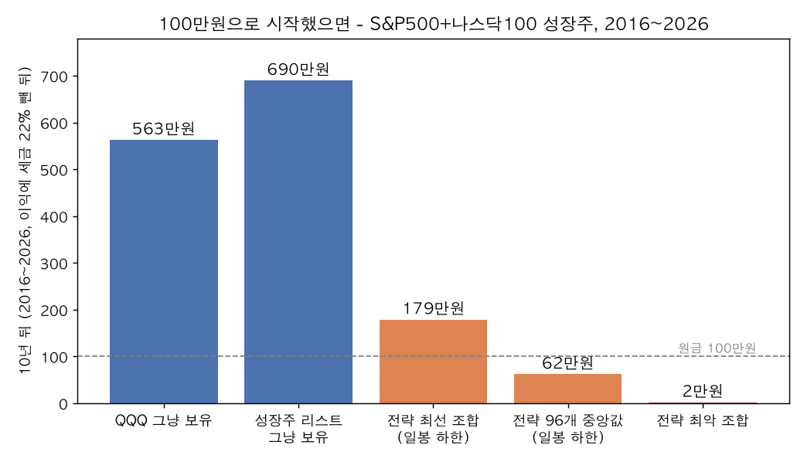
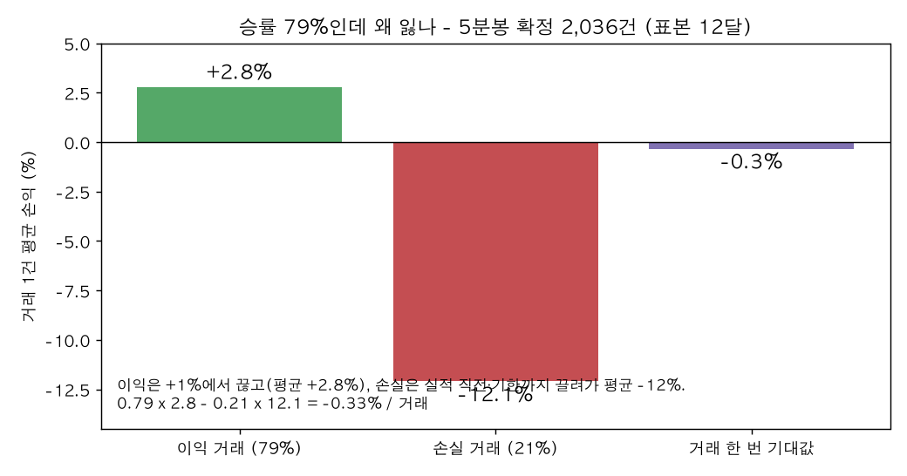
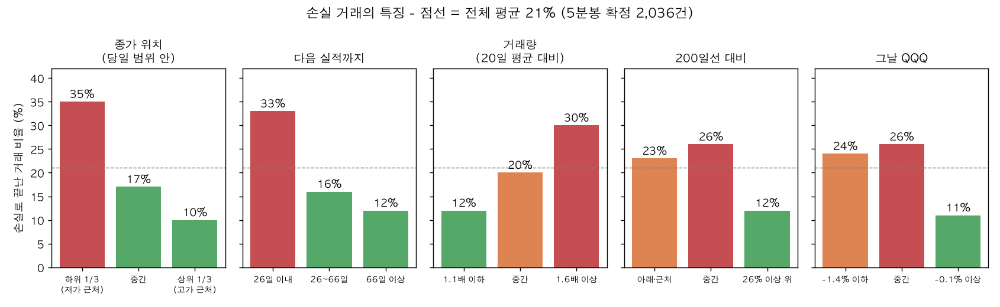

# 성장주 당일 눌림 +1% 매매 — 쉬운 요약 (2026-10-31)

기술 문서 `성장주_당일눌림_1퍼센트_검증_2026-10.md` 를 숫자 몇 개와 그림 세 장으로 줄인 것. 설계는 `성장주_당일눌림_1퍼센트_설계_2026-10.md`.

---

## 1. 무엇을 시험했나 (한 문장)

**"매출·이익이 크게 느는 회사(미너비니 기준) 리스트를 들고 있다가, 그중 하나가 하루에 2~4% 떨어지면 그날 사서 +1% 만 먹고 나온다. 그날 안 오르면 +5~10% 오르거나, 다음 실적 발표 하루 전이거나, 20~60일이 지나면 판다."**

S&P500 + 나스닥100 의 518 종목, 2016~2026 의 10년, 192 가지 설정으로 돌렸고, 그중 12 가지는 5분봉으로 실제 체결까지 확인했다.

---

## 2. 결과 한 줄: **진다.** 그냥 들고 있는 것보다 훨씬 못하다.

| 100만원을 2016년에 넣었으면 2026년에 (세금 뺀 뒤) | |
|---|---|
| QQQ 그냥 보유 | 563만원 |
| 같은 성장주 리스트를 그냥 매주 똑같이 나눠 보유 | **690만원** |
| 이 전략, 192개 설정 중 **제일 잘 된 것** | 179만원 |
| 이 전략, 보통(중앙값) | 62만원 (원금 손실) |
| 이 전략, 제일 못 된 것 | 2만원 |

- "제일 잘 된 것"도 그냥 보유의 1/4 이다. 10년에 걸쳐 설정을 192개나 바꿔 봤는데도 그렇다.
- 전략이 돈을 넣고 있는 시간은 전체의 22% 뿐이다. 나머지 78% 는 현금이다. 오를 때 못 먹고, 떨어질 때(실적 발표 쇼크)는 다 맞는다.

---

## 3. 승률은 79% 인데 왜 잃나

- 5분봉으로 확인한 2,036 건: **열 번 중 여덟 번은 이익**이다. 그래서 겉으로는 잘 되는 것처럼 보인다.
- 그런데 **이익은 +1% 에서 바로 끊고**(평균 +2.8%), **손실은 끊지 않는다**(손절 규칙이 없고 실적 직전·기한까지 끌려가 평균 −12%).
- 열 번에 여덟 번 +2.8%, 두 번 −12% → 한 번 거래할 때마다 평균 **−0.33%**. 100 번 하면 −30%.
- 당일에 +1% 가 실제로 나오는 비율은 **절반(42~54%)** 뿐이다. 나머지 절반은 "당일 매매"가 아니라 "손절 없는 보유"가 되어 버린다.

---

## 4. 가장 중요한 발견: 성장주라서 반등하는 게 아니다

같은 "하루 2~4% 하락" 조건을 **리스트에 없는 종목**에 걸어 봤다(플라세보 A). **192 가지 설정 전부에서 리스트 밖 종목이 더 잘 반등했다.**

즉 "떨어진 날 사면 조금 반등한다"는 현상은 아무 종목에나 있고, 성장주는 오히려 떨어지기 시작하면 더 떨어진다(2021~2022 년에 특히). "성장하는 회사" 라는 근거가 이 매매에선 **마이너스** 였다.

---

## 5. 손실 거래의 특징 — 피할 수 있는 것과 없는 것

손실로 끝난 거래(전체의 21%)는 산 날에 이미 이런 모습이었다.

| 특징 | 이런 날은 손실 비율 | 반대는 |
|---|---|---|
| **종가가 그날 저가 근처**(범위 하위 1/3) | **35%** | 고가 근처면 10% |
| **다음 실적 발표가 26일 이내** | **33%** | 66일 이상 남았으면 12% |
| **거래량이 평소의 1.6배 이상** (뉴스가 있는 하락) | **30%** | 평소 수준이면 12% |
| 주가가 200일선 아래·근처 (추세가 약한 종목) | 23~26% | 200일선 26% 이상 위면 12% |
| 그날 QQQ 도 −1.4% 이상 하락 | 24~26% | QQQ 가 안 떨어진 날 11% |
| 금요일 | 29% | 월요일 15% |
| 주가 $120 이상의 비싼 종목 (TSLA·COIN·MSTR 류) | 28% | $50 이하 15% |

- 손실의 **80% 는 "실적 직전 강제 매도"** 로 끝난다. 반등을 기다리다 실적 전날 −9% 평균으로 판다. 처음부터 실적이 가까운 종목을 안 샀으면 손실의 1/3 은 없었다.
- "종가가 저가 근처" 는 **살 때는 모르고 그날 장 끝나야 아는** 것이다. 쓰려면 "종가가 범위 하위 1/3 이면 그날 종가에 바로 판다" 는 **당일 손절** 규칙이 된다.
- 거래량 급증·추세 약함·지수 급락은 살 때 알 수 있다. 다만 이 셋을 다 거르면 거래 수가 1/3 로 줄고, 그래도 플라세보 A 를 이기는지는 다시 돌려 봐야 안다.

---

## 6. 주의: 일봉으로만 보면 "승률 100%" 가 나온다 (착시)

일봉에는 장중 순서가 없다. "당일 고가가 진입가보다 1% 위였으면 익절" 로 세면, **시가 기준 −X% 에서 산 경우 고가는 항상 시가보다 높으므로 항상 익절**이다. 그래서 일봉 낙관 계산은 +1,700% ~ +4천만 % 가 나왔고 전부 가짜다. 분봉 없이 "승률 9 할" 이라는 결과를 보면 이 착시를 먼저 의심한다.

---

## 7. 결론

- **기각.** 가설 장부 R16. 세후로 QQQ 를 이긴 설정 0 개, 플라세보를 이긴 설정 0 개.
- 그래도 방향이 맞았던 손잡이: 당일 **시가** 기준 하락(전일 종가 기준보다 +0.2%p), **산업군 대비 저PER** 종목(+0.4%p), **큰 하락(4%)**, **길게 보유**. 다 합쳐도 그냥 보유에 진다.
- **소형주는 더 나쁘다.** S&P·나스닥100 밖의 나스닥 보통주 2,079 종목으로 같은 실험(기술 문서 §12): 100만원이 10년 뒤 보통 **0원 근처**(96개 설정 중앙값 −99.8%, 제일 잘 된 것도 −75%). 5분봉 확정 거래당 −1.0 ~ −2.1%, 12개 설정 전부 음수. 실적 직전 청산 평균 −13%, 기한 청산 −45%, 최악 −85%. 소형주에서는 리스트 밖 종목도 반등하지 않는다(플라세보도 음수). 소형 성장주 리스트를 그냥 들어도 +200% 로 QQQ(+594%)에 진다.

## 8. 손실 방지 필터를 넣으면 (기술 문서 §13)

§5 의 특징으로 네 가지 필터를 만들어 48 조합을 다시 돌렸다.

| 필터 | 효과 (5분봉 확정, 거래당) | 판정 |
|---|---|---|
| 거래량이 평소(20일 평균)의 1.5배를 넘으면 안 산다 | **+0.5%p** | 가장 확실. 거래 수도 안 줄어듦 |
| 200일선보다 20% 이상 위에 있는 종목만 (추세) | **+0.4%p**, 그리고 리스트 밖 종목(플라세보)은 −0.9%p 로 나빠짐 | "성장 + 추세" 가 처음으로 리스트 밖과 구별됨 |
| 다음 실적까지 20 거래일 이상 남은 종목만 | +0.04%p (일봉으로는 +0.65%p) | 실적 직전 −9% 청산은 사라지지만 그 자리에 기한 청산이 들어옴 |
| 종가가 그날 범위 하위 1/3 이면 그날 종가에 손절 | **−1.8%p, 승률 77% → 45%** | **기각.** 3% 떨어진 날의 절반이 저가 근처 마감이라 거의 매번 −3~5% 를 확정하고, 그중 다수는 다음 날 익절될 거래였다 |

셋을 다 켜면(종가 손절 빼고): 10년 일봉 계산으로는 100만원이 **541~1,044만원**(QQQ 563만원, 리스트 보유 690만원)까지 나온다. 하지만 **5분봉으로 확인한 12달**에서는 거래 한 번에 −0.3 ~ +0.7%, 12달에 −12 ~ +15% 로 그 1/3 이고, 같은 종목을 아무 날이나 사서 든 것(+2.1%/거래)을 못 이긴다. 실적 갭 꼬리(하루 −12~16%)도 그대로다.

**결론은 여전히 기각**이지만 이유가 바뀌었다. 필터 전엔 "성장주 리스트가 오히려 해롭다" 였고, 필터 후엔 "거래량 평소 수준 + 추세 강한 성장주의 눌림은 분명 더 잘 반등하지만, +1% 에 끊고 손절 없이 끌고 가는 틀이 그 우위를 다 깎아 먹는다" 이다. 다음 단계가 있다면 "당일 +1%" 를 버리고 추세 성장주 눌림을 손절 있는 스윙으로 다시 설계하는 것이다.

엔진 기본값은 이 세 필터를 켠 상태로 바꿨다(`min_days_to_earnings=20`, `max_vol_ratio=1.5`, `trend_filter="sma200+20"`).

## 9. "떨어짐" 을 PER 로 정의하고, PER 이 낮은 동안 들고 있으면 (기술 문서 §14·§15)

"그 회사가 원래 받던 PER(1년 중앙값)보다 20~40% 싸진 날" 을 떨어진 날로 보고, (A) 기존 청산 그대로 / (B) PER 이 원래대로 돌아올 때까지 보유 — 두 가지로 다시 돌렸다.

| | 거래 수(10년) | 보유 | 100만원 → (세후) | 리스트 밖 종목과 비교 |
|---|---|---|---|---|
| A: PER 트리거 + 당일 +1%/10%/실적 전/60일 | 70~527 | 20일 | 103 ~ **777만원** (보통 315만원) | **처음으로 리스트 종목이 더 잘 반등** (12개 중 10개) |
| B: PER 트리거 + PER 회복까지 보유 | **10~41** | **1.3~5년** | 181 ~ **988만원** (보통 449만원) | 거래당 +78% vs 밖 +40% |
| QQQ 그냥 보유 | | | 563만원 | |
| 리스트 그냥 보유 | | | 690만원 | |

- 좋아진 것: 당일 눌림에선 리스트 밖 종목이 항상 더 잘 반등했는데(§4), PER 기준으로 바꾸면 **리스트 종목이 더 잘 반등**한다. "성장하는 회사가 이익 대비 싸졌을 때" 라는 근거는 종목을 고르는 데는 쓸 만하다.
- 안 되는 것: 그래도 QQQ 를 이긴 설정은 A 12개 중 1개, B 24개 중 3개뿐이고, 리스트를 그냥 든 것(690만원)을 이긴 것은 B 3개뿐. B 는 한 번 사면 평균 2~3년을 들고 있어 **자본 대부분이 현금**이다 — 거래당 +78% 가 연 7% 밖에 안 된다. 같은 종목을 아무 날이나 사서 같은 규칙으로 든 것(플라세보 B, 519~809만원)이 B 설정 24개 중 15개를 이긴다. 손절이 없어 −83% 거래도 있다.
- 결론: **여전히 기각.** "싸진 성장주" 는 종목 선택 근거로는 맞지만, 타이밍 전략으로 만들면 현금 때문에 그냥 보유에 진다.

### 9-1. 사람이 체크리스트로 골랐으면 (기술 문서 §15)

상승장·하락장·보합장 달을 2개씩(6개 달) 뽑아 후보 46개를 **그날까지의 차트·숫자만** 보고 사람 규칙으로 판정했다(발표 갭 −8%·EPS 꺾임·PER 60 이상·추세 꺾임·종목만 급락이면 건너뜀). 다음날 시가에 사서 PER 이 회복되면 팔고, 최대 1년.

| | 건수 | 1년 뒤 평균 |
|---|---|---|
| 자동(후보 전부 매수) | 46 | +18.5% |
| 사람이 산 것 | 11 | **+7.6%** |
| 사람이 버린 것 | 35 | **+21.9%** |
| QQQ 같은 기간 | | +14.2% |

- 체크리스트는 **거꾸로 작동했다.** 가장 많이 거른 "추세가 꺾인 종목"(22건)이 그 뒤 1년 평균 +32% — PER 눌림은 원래 추세가 꺾인 자리에서 나오므로, 추세로 거르면 하락장 바닥(2019-01, 2022-09)의 후보가 전부 사라진다.
- 진짜 갈림은 **왜 싸졌나** 였다: 이익이 늘어서 싸진 종목(23건)은 1년 뒤 +4%, 가격이 떨어져서 싸진 종목(22건)은 +31%. 체크리스트는 전자를 사라고 하고 있었다.
- 맞은 것 하나: 2021년 상승장의 PER 60 이상 종목(CRM·NFLX·AMZN·XYZ·AMD)은 거르는 게 맞았다(−41%).
- 표본이 6개 달·46건이라 숫자는 거칠지만, 항목의 방향(추세 필터 ✗, 거품 PER ✓, "EPS 상승형 환영" ✗)은 분명하다. 고친 규칙은 새 표본에서 다시 봐야 한다.

### 9-2. 자동 결과에서 "잘 된 거래 / 망한 거래" 를 갈라 보니 (기술 문서 §16)

6개 달 46건 대신 같은 PER 트리거의 2017~2025 전체 532건을 같은 규칙(다음날 사서 PER 회복 또는 1년)으로 정산하고, 산 날의 특징을 손실 거래(141건)와 이익 거래로 나눠 비교했다. 2017~2021 과 2022~2025 로 반 갈라 **둘 다 같은 방향인 것만** 믿었다.

| 산 날의 모습 | 1년 뒤 손실 비율 | 1년 뒤 중앙값 |
|---|---|---|
| 주가가 200일선보다 10% 이상 **아래** (떨어져서 싸진 것) | **12~14%** | **+30%** |
| 주가가 200일선 **위** (이익이 늘어서 싸진 것, 고점 근처) | 35~44% | +7~13% |
| 이익이 늘어서 싸졌고 52주 고점 10% 이내 | 36% | +10% |
| 최근 분기 이익이 작년의 2배 이상 (저베이스·피크) | 29~36% | |
| 실적 발표 뒤 12일 이내 | 25~34% | |
| 원래 PER 계산 창에 적자 탈출 직후 구간이 섞임 (창 최대 ÷ 원래 ≥ 1.5) | 24~33% | |

- 사람이 적었던 체크리스트(§9-1)와 **정반대**다. "추세가 살아 있는 종목만" 이 아니라 **"추세가 꺾여서 싸진 종목만"** 사야 하고, "이익이 늘어 싸진 종목" 은 피해야 한다.
- 고친 규칙(200일선 −10% 아래 + 원래 PER 창 오염 없음)을 §9-1 의 46건에 다시 대면: 통과 14건 평균 **+38%**(손실 1건), 걸러진 32건 +10%(손실 13건). 사람 판정(11건 +7.6%)보다 훨씬 낫다. 다만 이 46건은 규칙을 만든 532건 안에 있으므로 확인이지 증명은 아니다.
- 그래도 QQQ 를 이기진 못한다: 고친 규칙으로 고른 188건도 2017~2021 에는 QQQ 보다 6%p 못했고 2022~ 에만 14%p 앞섰다. 이 체크리스트는 "어느 눌림이 안 망하나" 를 가를 뿐이다.

### 9-3. 고친 체크리스트를 자동 필터로 넣고 전부 돌리면 (기술 문서 §17)

§9-2 의 다섯 항목(가격 250일 중앙 −10% 아래 / 200일선 −10% 아래 / 원래 PER 창 오염 없음 / 최근 분기 이익 2배 이하 / 발표 뒤 13일 이상)을 엔진 필터로 넣고 켬·끔 32 조합씩, 네 가지 판으로 돌렸다.

| 판 | 필터 켜면 거래당·승률 | 필터 켜면 10년 누적(세후) | QQQ 이김 |
|---|---|---|---|
| PER 회복까지 보유, 사실상 전부 매수 (50종목·2%) | 거래당 +19.5 → +23%, 승률 81 → 84%, 최악 −61 → −50%, 다섯 다 켜면 승률 **90%**·MDD −9% | **내려감** (+85 → +50%, 다섯 다 켜면 +60% vs 끔 +207%) | 0/64 |
| 같은 규칙, 5종목 / 10종목 | 조합당 거래 20~50건이라 들쭉날쭉 | 내려감 | 1/64, 0/64 |
| 당일 +1% 뒤 짧게 보유 (기존 청산) | 거래당 +2.4 → +3.6%, 승률 77 → 82% | **올라감** (+67 → +85%, 최고 +124%) | 0/32 |

- 필터는 약속한 일을 한다: 망하는 거래를 줄이고(승률 90%), 최악 거래와 낙폭을 반으로 줄인다. "가격이 떨어져 싸진 것" 과 "200일선 아래" 두 항목만 효과가 있고 나머지 셋은 없다.
- 그런데 오래 들고 가는 판에서는 **거래가 30% 줄어 돈이 현금에 더 오래 놀고**, 누적은 오히려 내려간다. 짧게 들고 가는 판에서만 누적도 올라간다.
- 어느 판이든 QQQ(563만원)·리스트 보유(690만원)를 못 넘고, 같은 종목을 매일 빈자리에 채워 넣는 플라세보가 전부 이긴다. 결론은 §9 와 같다: 이 필터는 **"어떤 싸진 성장주를 살까" 를 고르는 데** 쓰고, 언제 사고팔지를 정하는 전략으로는 쓰지 않는다. 엔진 기본값은 꺼 둔다.
