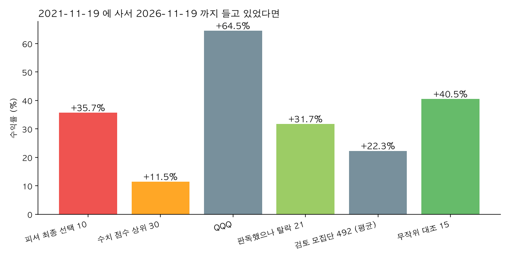
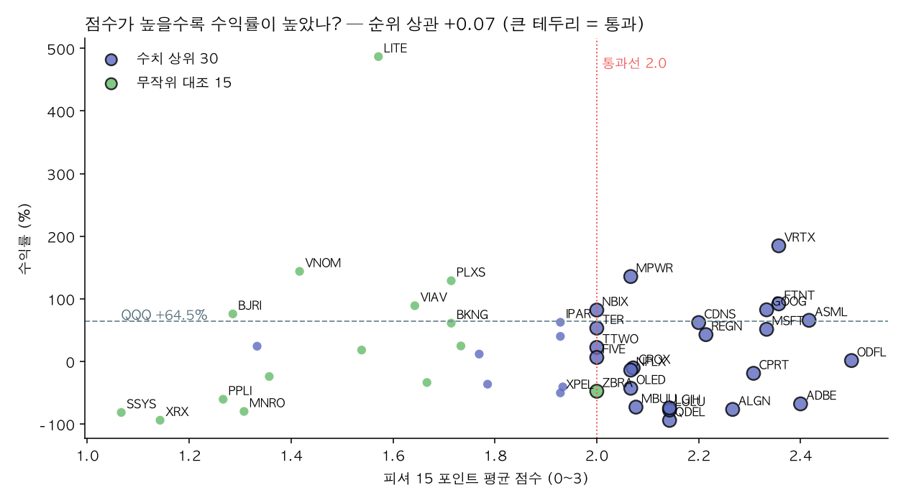

# 피셔 15 포인트 5년 검증 — 2021-11-19 에 골라 2026-11-19 까지 보유 (2026-11-20)

체크리스트: `피셔_위대한기업_체크리스트_2026-11.md` · 1년 판: `피셔_15포인트_1년검증_2026-11.md` · 원본: `fisher_runs/2021-11-19/` · 선택 10종목의 항목별 점수 근거: `피셔_5년검증_선택10종목_항목별근거_2026-11.md`
방법은 1년 판과 완전히 같다(같은 코드·같은 문턱·같은 모델). 기준일만 5년 전으로 옮겼다.

## 결론

**5년 전 자료로 고른 10종목은 5년 동안 평균 +35.7%(연 6.3%)였다. 같은 기간 QQQ 는 +64.5%(연 10.5%)로, QQQ 에 졌다.**
다만 1년 판과 달리 **무작위 10종목(평균 +21.8%)보다는 나았고**(무작위 분포의 72% 자리), 수치 점수가 높은 묶음일수록 수익률이 높았다(1년 판은 반대였다).
무작위의 72% 자리는 운으로도 흔히 나오는 범위라 "선별력이 있다"고 말할 수준은 아니다.

| | 1년 판 (2025-11 → 2026-11) | 5년 판 (2021-11 → 2026-11) |
|---|---|---|
| 피셔 최종 선택 10 | +1.5% | **+35.7%** (연 6.3%) |
| QQQ | +10.5% | **+64.5%** (연 10.5%) |
| 무작위 10종목 평균 | +20.4% | +21.8% |
| 선택의 무작위 대비 위치 | 하위 18% | 72% |
| 모집단 평균 / 중앙 | +20.2% / +12.9% | +22.3% / **−5.1%** |
| 모집단 중 QQQ 이긴 비율 | 50% | **22%** |
| 수치 점수 ↔ 수익률 순위 상관 (모집단) | −0.14 | **+0.11** |
| 피셔 점수 ↔ 수익률 순위 상관 (판독 45) | −0.19 | +0.07 |

## 1. 깔때기

| 단계 | 남은 종목 |
|---|---|
| 2021-11-19 나스닥 상장 (ETF 제외, 이후 상장폐지 포함) | 4,400 |
| 분기 재무제표가 캐시에 있음 | 1,815 |
| 주가 ≥ $5, 20일 평균 거래대금 ≥ $5M | 809 |
| 금융·부동산 제외 | 699 |
| 최근 12개월 매출 ≥ $1억, 발표된 분기 ≥ 16개 | 494 → 492 |
| 수치 상위 30 + 무작위 대조 15 → AI 판독 | 45 |
| 15 포인트 통과 | 24 |
| 최종 선택 (평균 점수 상위 10) | 10 |

판독 비용 $9.28 (Claude Opus 5.5, 45종목).

## 2. 결과

| 묶음 | 종목 수 | 평균 | 중앙 | 오른 비율 | QQQ 이긴 비율 | 최고 | 최악 |
|---|---|---|---|---|---|---|---|
| **피셔 최종 선택** | 10 | **+35.7%** | +47.1% | 70% | 40% | +184.7% | −76.6% |
| 피셔 통과 전체 | 24 | +11.9% | +3.9% | 54% | 25% | +184.7% | −94.2% |
| 판독했으나 탈락 | 21 | +31.7% | +18.2% | 57% | 24% | +486.9% | −93.9% |
| 수치 상위 30 (AI 판독 전) | 30 | +11.5% | +9.0% | 57% | 20% | +184.7% | −94.2% |
| 무작위 대조 15 | 15 | +40.5% | +18.2% | 53% | 33% | +486.9% | −93.9% |
| QQQ | — | +64.5% | | | | | |
| 검토 모집단 492 (2026-11-10 까지, 같은 기간 QQQ +72.1%) | 492 | +22.3% | −5.1% | | 22% | | |

- 무작위 대조 15의 평균 +40.5% 는 LITE 한 종목(+487%)이 끌어올린 값이다. 중앙은 +18.2%.
- 모집단에서 10종목을 2,000번 뽑으면 평균 +21.8%, 5~95% 범위 −29.8% ~ +92.5%. 최종 선택은 같은 기준(+38.2%)으로 **72% 자리**.
- 수치 점수 상위 10종목(AI 없음)은 +25.1%.

**최종 선택 10종목**

| 종목 | 섹터 | 피셔 평균 | 5년 수익률 |
|---|---|---|---|
| ODFL | 산업재 | 2.50 | +1.4% |
| ASML | 기술 | 2.42 | +65.6% |
| ADBE | 기술 | 2.40 | −67.8% |
| VRTX | 헬스케어 | 2.36 | +184.7% |
| FTNT | 기술 | 2.36 | +91.9% |
| MSFT | 기술 | 2.33 | +51.3% |
| GOOG | 커뮤니케이션 | 2.33 | +82.4% |
| CPRT | 산업재 | 2.31 | −19.0% |
| ALGN | 헬스케어 | 2.27 | −76.6% |
| REGN | 헬스케어 | 2.21 | +42.8% |

10종목 중 QQQ 를 이긴 것은 4개(VRTX·FTNT·GOOG·ASML)다.

## 3. 점수가 수익률을 맞혔나

수치 점수 5분위 (모집단 492, AI 없음):

| 분위 | 종목 수 | 평균 | 중앙 |
|---|---|---|---|
| 하위 20% | 99 | +8.4% | −31.4% |
| 20~40% | 98 | +22.1% | −23.5% |
| 40~60% | 98 | +21.3% | +3.6% |
| 60~80% | 98 | +24.8% | −1.0% |
| 상위 20% | 99 | +34.9% | +11.9% |

→ 5년으로 보면 **품질 점수가 높은 묶음이 더 올랐다**(1년 판과 반대 방향). 그래도 상위 20% 의 평균 +34.9% 는 QQQ(+72.1%)의 절반이다.

AI 판독이 수치에 더한 것:
- 통과 24종목 평균 +11.9% < 탈락 21종목 +31.7%. 통과 전체로는 오히려 나빴다.
- 그러나 통과 종목 안에서 **점수 상위 10** 은 +35.7%, 나머지 통과 14종목은 −5.1% 였다. 상위에 든 것과 아닌 것의 차이는 컸지만 14 대 10 종목의 비교라 우연과 구별되지 않는다.
- 통과했지만 크게 내린 종목: QDEL −94%(코로나 진단 매출이 2021년에 정점), LULU −78%, ALGN −77%, LGIH −74%, MBUU −73%, ADBE −68%. **2021년의 높은 성장률·이익률이 코로나 특수였던 회사**를 재무제표와 10-K 로는 걸러내지 못했다.

포인트별 (판독 45종목, 표본이 작아 참고만):

| 포인트 | 2~3점 수 | 평균 수익 | 0~1점 수 | 평균 수익 | 모름 |
|---|---|---|---|---|---|
| 1 시장 잠재력 | 30 | +9.9% | 15 | +43.6% | 0 |
| 2 신제품 의지 | 32 | +27.2% | 12 | +4.7% | 1 |
| 3 R&D 효과 | 21 | +46.7% | 6 | −26.0% | 18 |
| 4 영업 조직 | 26 | +10.3% | 15 | +28.7% | 4 |
| 5 이익률 | 35 | +30.5% | 10 | −11.6% | 0 |
| 6 이익률 개선 | 32 | +31.7% | 13 | −4.7% | 0 |
| 7 노사 관계 | 12 | +0.6% | 27 | +22.8% | 6 |
| 8 임원 관계 | 22 | +20.5% | 21 | +16.3% | 2 |
| 9 경영진 깊이 | 22 | +24.5% | 12 | +1.2% | 11 |
| 10 원가·회계 | 44 | +22.8% | 1 | −50.3% | 0 |
| 11 업종 우위 | 37 | +27.6% | 7 | −13.2% | 1 |
| 12 장기 시각 | 40 | +19.7% | 5 | +32.4% | 0 |
| 13 증자·희석 | 35 | +5.5% | 10 | +75.9% | 0 |
| 14 솔직함 | 42 | +8.9% | 2 | +276.2% | 1 |
| 15 정직성 | 44 | +22.2% | 1 | −24.1% | 0 |

5년으로는 이익률(5·6)·R&D(3)·업종 우위(11)·신제품(2)·경영진 깊이(9)에서 높은 점수 쪽이 나았다. 13·14 의 낮은 점수 쪽 수치는 LITE(+487%) 한 종목이 만든 것이다.

## 4. 왜 QQQ 에 졌나 — 해석 (추정)

1. **시작점이 고점이었다.** 2021-11 은 성장주 거품의 꼭대기였다. 모집단 492종목의 중앙 수익률이 5년간 −5.1% 이고 QQQ 를 이긴 종목은 22% 뿐이다. QQQ 의 +64.5% 는 소수 초대형주가 만든 수익이라, 동일 비중 10종목이 따라가기 어려운 구간이었다.
2. **코로나 특수를 '탁월한 성장'으로 읽었다.** 3·5년 성장률을 그대로 쓰는 수치 포인트는 일시적 호황과 지속 성장을 구별하지 못한다. 책은 이것을 사람에게 물어 구별하라고 한다.
3. **동일 비중.** 선택 10종목에 MSFT·GOOG 가 있었지만 각 10% 였다.

## 5. 한계

- **생존 편향 (1년 판보다 훨씬 크다).** 재무제표 캐시는 **지금 상장돼 있는 종목**만 갖고 있다. 2021-11-19 에 유동성 조건을 채운 나스닥 1,220종목 중 재무제표가 있는 것은 811개였고, 없는 409개(대부분 그 뒤 상장폐지·인수)의 5년 평균은 −11.5%, 있는 쪽은 +6.2% 였다. 즉 모집단과 무작위 대조는 **실제보다 좋게** 나온 숫자다. 선택 10종목은 모두 살아남은 대형주라 영향이 작지만, "무작위보다 나았다"의 격차는 실제로는 조금 더 컸을 수 있다.
- **AI 의 기억 오염.** 5년 판은 1년 판보다 위험이 크다. 모델은 2021~2026 의 일을 학습했다. 회사 이름은 가렸지만 본문으로 알아볼 수 있다. 다만 ADBE·ALGN·QDEL·LULU 처럼 크게 내린 종목을 통과시킨 것을 보면 미래를 알고 고른 흔적은 약하다.
- **재작성된 재무제표.** Alpha Vantage 의 현재 값이라 일부 분기는 나중에 고쳐진 수치다.
- **배당.** 판독 45종목과 QQQ 는 배당 포함(yfinance), 모집단 492종목은 분할만 조정한 가격이라 5년 배당만큼 낮게 나온다(나스닥 종목이라 크지 않다).
- **상장폐지 종목**은 마지막 거래 가격으로 정산하고 그 뒤는 현금으로 본다.
- **표본.** 기준일 1개·10종목. scuttlebutt 없음, 문턱은 [가정] — 1년 판과 같다.
- 세금·수수료 없음.

## 6. 두 판을 합쳐서 말할 수 있는 것

- 문서와 숫자로 흉내 낸 피셔 선별은 **두 기준일 모두 QQQ 에 졌다.**
- 무작위 종목 대비로는 1년 판은 아래(18%), 5년 판은 위(72%) — 방향이 갈렸고 둘 다 운의 범위 안이다.
- 품질 점수와 수익률의 관계는 1년은 음, 5년은 약한 양. 책의 주장("탁월한 회사를 오래")과 방향은 맞지만, 기준일 하나로는 근거가 약하다.
- 확인하려면 기준일을 여러 개(예: 2015·2017·2019)로 늘려야 한다. 기준일당 약 $10.
