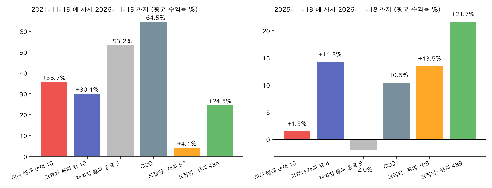
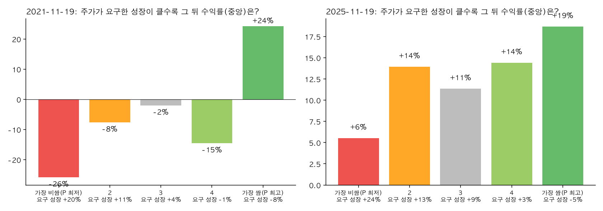

# 피셔 15 포인트 + 모부신 예측투자(고평가 제외) 검증 (2026-11-22)

체크리스트: `모부신_예측투자_고평가제외_체크리스트_2026-11.md` · 쉬운 설명: `모부신_예측투자_쉬운설명_2026-11.md`
원본: `fisher_runs/2021-11-19/pie.md`·`pie.json`, `fisher_runs/2025-11-19/pie.md`·`pie.json` · 코드 `fisher_cli.py pie`, 엔진 `strategy/adapters/expectations_pie.py`
규칙(자본비용 = 10년 국채 + 5%p, 10년, 제외 = 기저율 P < 5%)은 결과를 보기 전에 체크리스트에 고정했다. AI 판독은 다시 하지 않았다(추가 비용 없음).

## 결론

**고평가 제외는 1년 판에서는 선택을 낫게 했고 5년 판에서는 조금 나쁘게 했다. 피셔 선택에 얹어 쓸 근거로는 부족하다.**
(정정: 처음 보고에서는 유로화로 보고하는 ASML 의 매출을 환산하지 않아 5년 판 새 선택이 +15.7% 로 나왔다. 환산 뒤 ASML 은 제외되지 않고 +30.1% 다.)

| | 5년 판 (2021-11 → 2026-11) | 1년 판 (2025-11 → 2026-11) |
|---|---|---|
| 원래 피셔 선택 10 | **+35.7%** | +1.5% |
| 고평가 제외 뒤 선택 | +30.1% (10종목) | **+14.3%** (4종목만 남음) |
| 제외된 통과 종목 | +53.2% (3종목: ADBE·FTNT·MPWR) | −2.0% (9종목) |
| QQQ | +64.5% | +10.5% |

- 5년 판: 원래 선택에서 **ADBE(−68%)와 FTNT(+92%)가 빠지고 CDNS(+62%)와 QDEL(−94%)이 들어왔다.** 빠진 둘의 합은 +24%p, 들어온 둘의 합은 −32%p 라 평균이 5.6%p 내려갔다. MPWR(+136%)도 제외됐지만 원래 10위 밖이었다.
- 1년 판: NVDA·NFLX·MELI·APP 같은 하락 종목을 뺐지만, 통과 13종목 중 9개가 제외돼 **4종목**만 남았다. PANW(+70%)도 빠졌다.
- 어느 쪽도 QQQ 를 넘는 10종목이 되지 못했다(1년 판 +14.3% 는 넘었지만 4종목이다).

**모집단 전체(AI 없음, 491·597종목)에서는 두 기준일 모두 같은 방향이었다** — 주가가 요구한 성장이 클수록 그 뒤 수익률이 낮았다. 순위 상관은 +0.10, +0.09 로 약하다.

| 모집단 | 5년 판 | 1년 판 |
|---|---|---|
| 제외(P < 5%) | 57종목, 평균 +4.1%, 중앙 −34.1% | 108종목, 평균 +13.5%, 중앙 +7.8% |
| 유지 | 434종목, 평균 +24.5%, 중앙 −3.1% | 489종목, 평균 +21.7%, 중앙 +14.0% |
| 품질 상위 20% 중 제외 | 22종목, 평균 +4.5% | 43종목, 평균 +3.6% |
| 품질 상위 20% 중 유지 | 101종목, 평균 +33.3% | 118종목, 평균 +14.5% |

## 1·2. 종목별 계산

통과 종목 37개(5년 판 24, 1년 판 13) 각각의 입력·역산·기저율·판정과, 누가 왜 빠지고 들어왔는지는 **`피셔_모부신_종목별_계산과정_2026-11.md`** 에 12단계로 풀어 썼다.

눈에 띄는 것:
- **"싸 보였던" 종목이 가장 크게 내렸다.** QDEL·LGIH·MBUU 는 주가가 매출 **감소**를 예상하고 있었고(P 97~99%), 실제로 그렇게 됐다(코로나 특수 소멸). 역산은 시장의 기대를 읽어 줄 뿐, 그 기대가 틀렸는지는 말해 주지 않는다.
- 제외된 종목 가운데 FTNT·MPWR·PANW 는 그 뒤 크게 올랐다. 기저율은 "스무 곳 중 한 곳"이라고 했고, 피셔 선별은 바로 그 한 곳을 찾으려는 방법이다.
- 1년 판은 금리가 올라 자본비용이 9.1%(2021년 6.5%)가 되면서 같은 주가가 훨씬 큰 성장을 요구하는 것으로 읽혀 9종목이 제외됐다.

## 3. 모집단 전체 — 요구 성장이 클수록 수익률은?

| P 5분위 | 5년 판: 요구 성장(중앙) | 평균 | 중앙 | 1년 판: 요구 성장(중앙) | 평균 | 중앙 |
|---|---|---|---|---|---|---|
| 가장 비쌈 | +20.2% | +5.5% | −25.9% | +23.8% | +12.4% | +5.5% |
| 2 | +11.1% | +6.3% | −7.7% | +13.2% | +17.2% | +13.9% |
| 3 | +4.0% | +18.2% | −2.0% | +9.0% | +22.6% | +11.4% |
| 4 | −0.5% | +19.2% | −14.6% | +3.3% | +24.2% | +14.5% |
| 가장 쌈 | −7.8% | +61.7% | +24.3% | −4.6% | +24.7% | +18.0% |

순위 상관: 5년 판 +0.10 (n=491), 1년 판 +0.09 (n=597). 방향은 같고 크기는 작다.

## 4. 민감도

| 설정 | 5년 판: 새 선택 평균 | 제외된 통과 종목 수 | 1년 판: 새 선택 평균 | 제외된 통과 종목 수 |
|---|---|---|---|---|
| 기본 (국채 + 5%p, P < 5%) | +30.1% | 3 | +14.3% | 9 |
| 자본비용 8% 고정 | −0.2% | 9 | +13.1% | 6 |
| 제외 문턱 P < 10% | +9.2% | 8 | −2.7% | 10 |
| 자본비용 +2%p | −0.2% | 10 | −13.1% | 11 |

피셔 선택에 얹은 결과는 설정에 따라 **크게 달라지고 부호도 바뀐다.** 모집단 쪽("제외 평균 < 유지 평균")은 네 설정·두 기준일 모두에서 유지됐다(`pie.md` 민감도 표).

## 5. 왜 이렇게 나왔나 — 해석 (추정)

1. **피셔 점수와 비싼 정도가 같이 움직인다.** 피셔 통과 종목 중 제외 비율은 13%(3/24), 69%(9/13)로 모집단의 12%, 18% 보다 높다. 좋은 회사는 이미 비싸고, 비싼 것을 빼면 피셔가 고른 것의 핵심이 빠진다.
2. **표본.** 10종목 평균은 한두 종목(FTNT·QDEL / NFLX·NVDA)이 정한다. 모집단 500종목에서는 그런 우연이 평균에 묻힌다.
3. **기저율이 낡았을 수 있다.** 표는 2015년까지의 세계 대형주다. 그 뒤 10년은 초대형 기술주가 표의 "0.2%" 구간 성장을 실제로 해낸 시기였다. 모부신의 후속 연구("무형자산이 기저율에 주는 영향")가 더 높은 빈도를 보고한다고 알려져 있으나 원문은 확인하지 못했다.
4. **역산은 1단계뿐이다.** 책은 기대를 읽은 뒤 "그 기대가 바뀔 것인가"를 판단하라고 한다. 여기서는 기저율 꼬리만으로 기계적으로 잘랐다.

## 6. 한계

- 기준일 2개. 한 번은 낫고 한 번은 못한 결과에서 결론을 내릴 수 없다.
- **보고 통화.** 재무제표 자료에 통화가 없어 Alpha Vantage 에서 따로 받아 환산했다(ASML·CCEP·FER 유로, PDD 위안). 피셔 `universe` 단계의 "매출 ≥ $1억" 거름은 환산 전 숫자를 쓰지만 이 네 곳은 어느 통화로도 기준을 넘는다.
- 책 그대로가 아니다: 컨센서스·시장 내재 예측 기간 대신 **10년 고정·성장률 역산**. 자본비용·세율·문턱은 [가정].
- 이익률을 지금 수준으로 고정했다. MELI·PANW 처럼 이익률이 낮은 성장 기업은 실제보다 비싸게 읽힌다.
- 기저율 표의 $325~700M 열은 원문에 합이 89.2% 로 인쇄돼 있다(가운데 칸 오식으로 보임). 꼬리 칸은 인쇄된 값 그대로 썼다.
- 주식 수는 Alpha Vantage 값(대개 현재 기준 분할 조정)에 분할 조정 종가를 곱했다. 주요 종목(MSFT·GOOG·NVDA)의 시가총액은 당시 실제와 맞는 것을 확인했다.
- 피셔 검증의 한계(생존 편향, AI 기억 오염, 재작성 재무제표, 세금·수수료 없음)는 그대로 이어진다. 5년 판 모집단은 살아남은 종목뿐이다.

## 7. 다음에 해 볼 수 있는 것 (요청 시)

- 기준일을 여러 해로 늘려 "모집단에서는 통하고 피셔 선택 안에서는 갈린다"가 반복되는지 확인 (역산은 AI 비용 없음. 피셔 판독은 기준일당 약 $10).
- 제외 대신 **비중 줄이기**, 또는 "높은 기대" 종목만 AI 에게 책 2단계(그 성장을 무엇이 만들 것인가)를 따로 판독시키기.
- 단순 배수(EV/매출) 거르개와 비교해 역산이 더하는 것이 있는지 분리.
