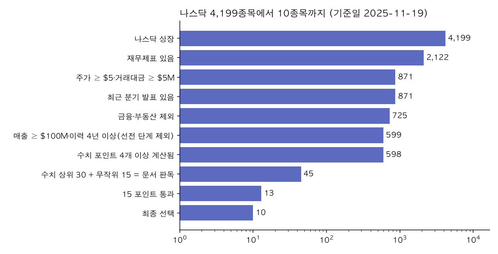
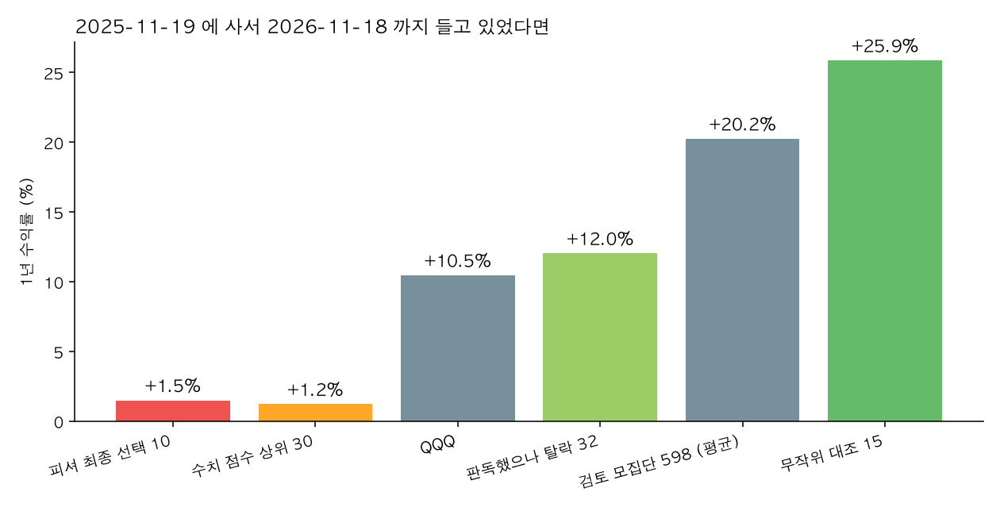
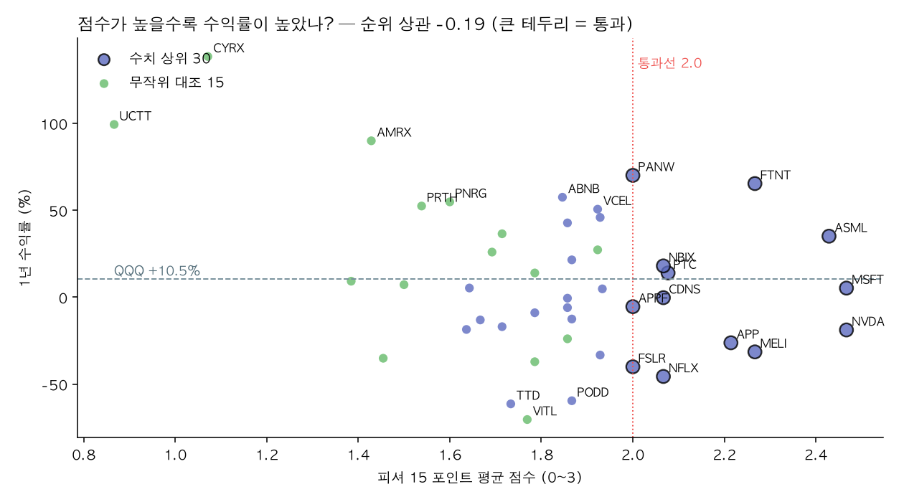
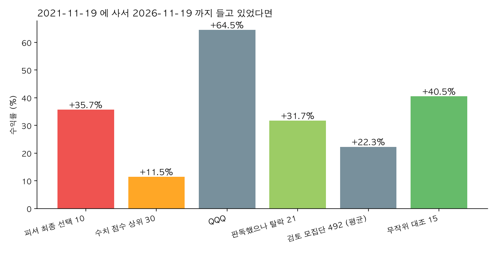

# 필립 피셔의 "위대한 기업" 고르는 법 — 쉬운 설명과 1년 시험 결과 (2026-11-19)

자세한 체크리스트는 `피셔_위대한기업_체크리스트_2026-11.md`, 숫자 전부는 `피셔_15포인트_1년검증_2026-11.md`.

## 1. 이 책이 말하는 것 — 세 문장

1. 큰돈은 **아주 좋은 회사를 사서 오래 들고 있을 때** 생긴다. 싸게 사서 비싸게 파는 재주가 아니다.
2. 아주 좋은 회사인지는 **15가지 질문**으로 확인한다.
3. 답은 재무제표가 아니라 **그 회사를 아는 사람들**(경쟁사, 고객, 납품업체, 옛 직원)에게 물어서 얻는다. 책은 이것을 "소문 수집(scuttlebutt)"이라 부른다.

## 2. 15가지 질문 — 다섯 묶음으로

| 묶음 | 질문 번호 | 쉬운 말 |
|---|---|---|
| **팔 물건이 계속 있나** | 1·2 | 앞으로 몇 년 매출이 크게 늘 제품이 있나? 그 다음에 팔 새 제품을 만들고 있나? |
| **연구·영업이 돈이 되나** | 3·4 | 연구비가 매출로 돌아오나? 물건을 잘 파는 조직인가? |
| **남는 장사인가** | 5·6·10 | 이익률이 업계에서 좋은 편인가? 그 이익률을 지키려고 무엇을 하나? 원가를 제대로 아나? |
| **사람과 조직** | 7·8·9·12 | 직원과 사이가 좋은가? 임원끼리 잘 지내나? 사장 한 사람에게 매달려 있지 않나? 당장의 이익보다 먼 앞을 보나? |
| **주주를 속이지 않나** | 13·14·15 | 주식을 마구 찍어 내 내 몫을 줄이지 않나? 나쁜 소식도 솔직히 말하나? **경영진이 정직한가?** |

- 대부분 "예"여야 한다. 여러 개가 "아니오"면 사지 않는다.
- **15번(정직)은 하나만 걸려도 끝이다.** 다른 14개가 다 좋아도 사지 않는다.

## 3. 사고파는 때

- **살 때**: 경기나 시장을 맞히려 하지 말 것. 좋은 회사가 **잠깐의 문제**(새 공장 초기 비용, 한 제품의 실패)로 눌렸을 때가 가장 좋다.
- **팔 때**: 이유는 셋뿐 — ① 처음 판단이 틀렸다 ② 회사가 더는 15가지를 채우지 못한다 ③ 훨씬 좋은 회사를 찾았다.
- **팔면 안 되는 이유**: "많이 올라서", "비싸 보여서", "약세장이 올 것 같아서".

## 4. 하지 말 것 (열 가지 중 자주 걸리는 것)

- 실적이 없는 신생 회사를 사지 말 것 — 확인할 것이 없다.
- 연차보고서의 **좋은 말투**에 넘어가지 말 것.
- 주가가 이익에 비해 높다고 해서 "이미 다 올랐다"고 단정하지 말 것.
- 너무 많은 종목으로 나누지 말 것 — 잘 아는 몇 개가 낫다.
- 남들을 따라 사지 말 것.

## 5. 우리가 한 시험

**질문**: 1년 전(2025-11-19)에 이 방법으로 나스닥에서 종목을 골랐다면 지금까지 얼마가 됐을까?

1. 그날 나스닥에 있던 4,199종목에서 시작해, 거래가 충분하고 매출 이력이 4년 넘는 598종목을 남겼다.
2. 재무제표 숫자로 계산되는 여섯 질문(1·3·5·6·12·13)에 점수를 매겨 **상위 30종목**을 뽑았다. 비교용으로 나머지에서 **아무거나 15종목**도 뽑았다.
3. 이 45종목의 **그날 이전에 나온 사업보고서**(10-K)를 AI 에게 읽히고 15가지 질문에 하나씩 0~3점을 매기게 했다. 회사 이름은 가렸다.
4. 정직(15번)에서 걸리거나 평균이 2점이 안 되면 탈락. 통과한 13종목 중 점수가 높은 10종목을 샀다고 쳤다.

사람을 만나 듣는 "소문 수집"은 과거로 돌아가 할 수 없어서, **회사가 스스로 쓴 문서**로 대신했다. 책의 방법과 가장 다른 부분이다.

## 6. 결과

- **고른 10종목: 평균 +1.5%.** 같은 기간 QQQ 는 +10.5%.
- 아무거나 뽑은 15종목은 +25.9%, 모집단 598종목 평균은 +20.2% 였다.
- 10종목을 아무렇게나 2,000번 뽑아 보면 평균 +20.4% 가 나온다. 우리가 고른 10종목은 그중 **아래에서 18% 자리**였다.

점수가 높은 회사일수록 오히려 덜 올랐다. 고른 종목은 NVDA(−19%), NFLX(−46%), MELI(−32%), APP(−26%)처럼 **이미 모두가 좋은 회사로 아는 큰 회사**였고, 이 1년은 그런 회사들이 쉬어 간 해였다. FTNT(+65%), ASML(+35%)은 잘 올랐다.

## 7. 그래서 이 방법은 쓸모없나?

그렇게 말할 수는 없다. 이 시험이 말해 주는 것과 말해 주지 못하는 것을 나눠 보면:

| 말해 주는 것 | 말해 주지 못하는 것 |
|---|---|
| 재무제표·사업보고서로 "좋은 회사"를 골라도 **1년 수익률은 보장되지 않는다** | 책이 말하는 **몇 년 이상** 보유의 결과 |
| 숫자로 좋아 보이는 회사는 이미 누구나 아는 회사다 | 사람을 만나 남보다 먼저 아는 **소문 수집**의 효과 |
| AI 가 문서를 읽고 매긴 점수는 숫자 점수와 거의 같은 종목을 골랐다 | 책 5장의 "잠깐 눌렸을 때 사기"의 효과 (하루에 다 샀다) |

## 7-1. 5년 들고 있었다면? (2026-11-20 추가)

책은 "오래 들고 있으라"고 하므로, 같은 방법으로 **5년 전(2021-11-19)** 에 골라 오늘까지 들고 있었다고 쳐 봤다. 숫자 전부는 `피셔_15포인트_5년검증_2026-11.md`.

- **고른 10종목: 5년에 +35.7%** (1년에 6.3%꼴). 같은 기간 **QQQ 는 +64.5%** (1년에 10.5%꼴). QQQ 에 졌다.
- 아무렇게나 뽑은 10종목(평균 +21.8%)보다는 나았다. 100번 뽑았을 때 위에서 28번째쯤 되는 자리로, 운으로도 흔히 나오는 정도다.
- 1년 시험과 달리 **점수가 높은 회사 묶음이 더 올랐다.** 방향은 책의 말과 맞는다.
- 잘 된 것: VRTX(+185%), FTNT(+92%), GOOG(+82%), ASML(+66%). 크게 틀린 것: ALGN(−77%), ADBE(−68%).
- 통과는 했지만 10위 안에 못 든 종목 중 QDEL(−94%), LULU(−78%)처럼 **코로나 때 잠깐 잘 팔린 회사**가 있었다. 숫자와 사업보고서만으로는 "잠깐 좋은 것"과 "계속 좋은 것"을 가려내지 못했다.
- 2021년 11월은 성장주가 가장 비쌌던 때라, 검토한 492종목 가운데 5년 동안 QQQ 를 이긴 것은 5개 중 1개뿐이었다.

## 8. 주의

- 10종목, 1년. 한두 종목이 평균을 뒤집는 크기다.
- AI 는 그 뒤 1년의 일을 알고 있을 수 있다. 이름을 가렸지만 완전히 막지는 못한다. (결과가 나쁜 쪽이라, 적어도 미래를 알고 좋게 고른 것은 아니다.)
- 통과 기준(평균 2점 등)은 책에 없는 숫자로, 이 시험이 정했다.
